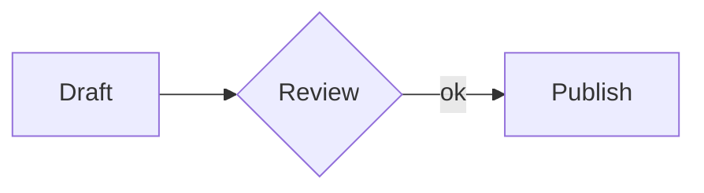
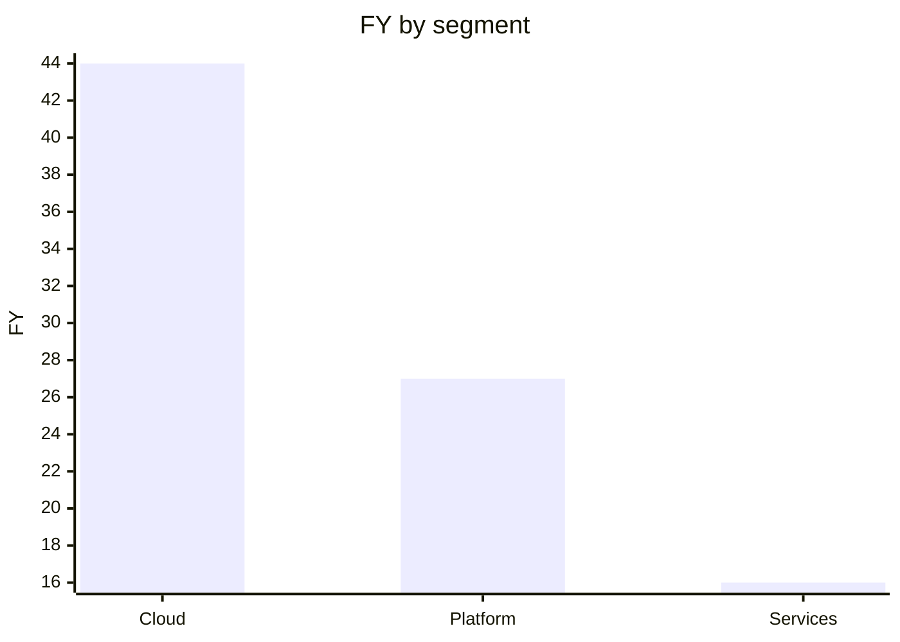

[](https://mcptoplist.com/server/io.github.geml-spec%2Fgeml) [](https://glama.ai/mcp/servers/geml-spec/geml) [](https://github.com/hashgraph-online/awesome-ai-plugins#development--workflow) [](https://github.com/mundimark/awesome-markdown#beyond-markdown---lets-fix-markdown-quirks--oddities-and-lets-fill-in--add-the-missing-parts-tables-footnotes-generic-blocks-etc) 


<p align="center">
  <picture>
    <source media="(prefers-color-scheme: dark)" srcset="docs/assets/logo/geml-logo-dark.svg">
    
  </picture>
</p>

# GEML — General Expressive Markup Language
[](https://www.npmjs.com/package/@geml/geml) [](https://modelcontextprotocol.io) [](https://github.com/geml-spec/geml/actions/workflows/ci.yml) [](https://github.com/geml-spec/geml/actions/workflows/geml-check.yml) [](spec/GEML-spec.md) [](LICENSE) [](spec/LICENSE-spec.md)

*English | [中文](README_CN.md)*

GEML is **a lightweight markup language with uniform, addressable blocks and standard verbs**.<br>
**Easy for humans to read, safe for agents to mutate.**
In agent-driven development and knowledge work, plain text and Markdown have no deterministic block boundaries: a program and a model trade the whole file in and the whole file back out — at best probing for it with line windows, and restating the original verbatim to rewrite it. Token cost grows with the length of the document, and the operation turns bloated. After a few rounds of rewriting, the copies excerpted elsewhere start to drift.

**Contents:** [What it solves](#problems) · [What an LLM needs](#why-now) · [What's different](#whats-different) ·
[The format in 1 minute](#one-minute) · [Profiles](#profiles) ·
[Get hands-on](#hands-on) · [With an LLM](#with-an-llm) ·
[Maturity & versions](#maturity) · [The design](#challenge) · [Roadmap](#roadmap) · [Take part](#contributing) ·
[License](#license)

**You can start without changing a thing.** `geml list`, `geml find` and `geml get` address the Markdown you already have — nothing is converted, no new files, your `.md` stays `.md`:

```sh
geml list    README.md                          # every section, as an address
geml get     README.md '#key-features'          # read ONE section, not the file
geml set     README.md '#key-features' --body   # write one section back
geml replace README.md 'old text' 'new text'    # swap a string, told which block held it
geml history save README.md -m 'tighten intro'  # a revision into README.md.gemlhistory, beside the file
```

Only that section enters the agent’s context — a couple of KB, not the whole file, however long it grows. And every save is a revision you can read back or roll back, one block or the whole file.

▶ **[Try it in the Playground](https://geml-spec.github.io/playground/)** — no install, nothing to read first.

Need finer than a section — one block, one chart, one table? Let `.geml` stand in the middle ground: edit at that grain, and the `--to md` you ship never drifts from it.

**A block has a name; the things inside it have a coordinate.** A table's cell, a
`data` block's leaf, a key in `meta` — each has a coordinate the structure already
gives it, and `get` and `set` land on exactly that value.

```sh
geml get doc.geml '#fy[2]["Q1"]'                     # one cell
geml set doc.geml '#intake["fields"][1]["name"]'     # one leaf in the JSON
```

For people, it is plain text that reads clean; for agents, it is an addressable, verifiable, traceable, revertible **["Doc-as-a-Base"](https://geml-spec.github.io/manifesto)**.

---

**GEML is minimal.**
It is plain text — still clean with no renderer in sight;
one block syntax for the whole language;
addressable, verifiable, referenceable structure, natively.

Instead of a separate mini-syntax for each kind of content, GEML carries every kind in one container: the typed block. Code is a block. So are tables, diagrams, math, callouts, even metadata — and a run of prose can be one too (`=== text`), whenever you want it addressable. Extending it later is just as plain. The shape is the same every time, which makes the language easy enough to learn that it's hard to get wrong.

Blocks have names so the verbs have somewhere to land — the full syntax is in
[the format in 1 minute](#one-minute).

<a id="problems"></a>
## What it solves

### Problems solved

1. **Context load and token bloat**: JSON/XML carry heavy wrapper syntax, and Markdown lacks structural metadata and references; GEML reads and writes only the target block, so context cost stops growing with document length.
2. **AST-level precision and parsing determinism**: unstructured text degrades over rounds of LLM reads and writes — broken formatting, semantic drift; GEML's deterministic grammar maps to an AST, so programs and LLMs create, read, update and delete one block at a time.
3. **Document copy fragmentation**: multi-agent work and shared pipelines pass content around by copy-paste, leaving copies that drift apart; GEML is built around a **single source of truth**, with standard references and data binding in place of copies.

### Key features

- **AST-level structured operations**: a document parses into a typed tree; an agent pinpoints its target and patches it in place, idempotently. Writes land as byte splices with whole-document re-validation, and every untouched byte stays as it was.
- **Low-token reads and writes**: what is saved is not markup characters but the part never read — `#id` hits one semantically complete block, and the rest never enters the context.
- **Single source of truth, modular references**: native cross-document, cross-fragment references; change the source once and every reference follows.
- **Robust two-way reads and writes**: one block shape for the whole language, easy to generate and hard to get wrong; a strict validator with precise error locations and repair feedback.
- **Profile-based domain extensibility**: declare a `profile` in `=== meta` to add a domain vocabulary (design styles, forms, code graphs, media timelines) without new syntax; a declared vocabulary is checked by its own checker, with safe fallback to standard blocks in unknown environments.

---

<a id="why-now"></a>
## What kind of text format does an LLM need?

Text in the AI era is "produced by models, read by people and models together".

Reading together means readability cannot be traded away; and when models settled on Markdown, it was a compromise made for want of anything better, not the final answer.

A text format built for people and models working together should change what reading and writing feel like for the machine:

- **Fine-grained**: address precisely by block, and by coordinate inside it — no more scanning the whole file;
- **Structured**: better organized, more flexible in what it holds;
- **Consistent**: one standard read/write interface, with other modalities extending it naturally;
- **Zero barrier**: minimal mental load, and a smooth, near-zero-cost migration.

Yet none of our existing text infrastructure was designed for this scene:

* **Markdown (typeset for people)**: no stable structural blocks, no machine keys. To change one parameter, an agent must read and write the whole text — **wasting context budget** across multi-turn loops, and inviting drift in both format and meaning.
* **JSON / XML (serialized for machines)**: full of wrapper syntax and structural noise — blocking natural human reading, while quietly eating expensive tokens in long contexts.
* **Scratch memory and scattered files (no single source of truth)**: context is torn across chat history and Markdown copies everywhere; a copy is drift from the moment it is made, and version skew and hallucinated distortion follow.

The root of all three failures is each tool's own virtue: Markdown's "never error, write anything" is what gives people their freedom to write — and exactly why a machine cannot trust the structure it reads back; JSON/XML's strict schema is what gives machines their certainty — and exactly why nobody writes prose in it. **The virtue is the defect, which is why patches cannot fix this**: bolting "a broken reference must fail the build" onto Markdown betrays its contract, and stripping the wrapper syntax from JSON denies its nature. When people and agents start co-writing the same text at high frequency, what is needed is not a compromise between the two poles, but a format that treats "readable by people" and "operable by machines" as **one design constraint from day one**.

### The answer: **["Doc-as-a-Base"](https://geml-spec.github.io/manifesto)**

GEML is a new format, but the wine is old: enhancing and unifying Markdown-style expression, stripping away HTML-style presentational syntax, and the idea of fenced blocks come from Markdown, `#id`s and embeds from XML and AsciiDoc, inline projection from Obsidian, and the verbs from the **[REST](https://www.ics.uci.edu/~fielding/pubs/dissertation/rest_arch_style.htm)** architectural style of Dr. Roy Fielding's dissertation. What is new is one block container for all of them. It is a little like TypeScript to JavaScript — the syntax can't be compatible, but `list`, `get`, `set`, `add` and `delete` already work on the Markdown you have. That container gives plain-text documents one standard set of operational semantics:

| Old pain | The matching capability (the four laws) | What it buys developers and agents |
| :--- | :--- | :--- |
| **Changing one spot means rewriting the whole text** | **The Law of Addressing** | Every block carries an `#id`; `get/set` reads and writes that block alone. **What is never loaded cannot be broken** — the context window stays yours. |
| **Copies everywhere, all drifting** | **The Law of Projection** | `=== embed` evaluates dynamically instead of copy-pasting; one definition at the source ends the labor of syncing copies. |
| **Bad formats / broken references pollute downstream** | **The Law of Validation** | References and syntax are checked at build time; **a bad write is stopped before it lands**, with no waiting for human review. |
| **One bad edit forces a whole-file rollback** | **The Law of Rollback** | The companion `.gemlhistory` reverts **a single block atomically** — no tearing down the page; a lightweight version safety net for agents. |

> **A document no longer needs just a format — it needs a set of verbs.** GEML keeps plain-text readability and adds deterministic block-level operations. The dilemma of engineering documents in the LLM era, and why these old practices belong in one new block container, is argued in full on the blog: [**"Why Do We Need a New Text Format in the Era of LLMs?"**](https://geml-spec.github.io/blog/2026/08/03/why-do-we-need-a-new-text-format-in-the-era-of-llms)

---

<a id="whats-different"></a>
## What's different about GEML

Where each format lands on the four capabilities of the last chapter — addressing, projection, validation, rollback — is the table below; GEML stays small on purpose, and what it refuses is in [how we thought about the design](#challenge).

### How other formats compare

Each of the four has mature solutions in its own field; what's unusual is meeting all four in one plain-text format:

| Family | What the state really is | Addressable / referenceable | Projectable / embeddable | Verifiable | History / traceability |
| :--- | :--- | :--- | :--- | :--- | :--- |
| **Word / Docs** | Opaque state | ❌ No block-level keys; access via platform APIs | ❌ Copy-paste only | ❌ No checking at all | ⚠️ Platform server-side, not in the file |
| **Markdown / AsciiDoc** | A stream of characters | ⚠️ Heading anchors or dialect ids; no read/write verbs | ⚠️ Dialect embeds (Obsidian `![[…]]`, `include::`) — break silently | ❌ Broken links fail silently | ❌ None in-format — external git required |
| **JSON / XML** | Data serialization | ✔️ (id / schema) | ⚠️ XML only (XInclude, external) | ✔️ Via an external toolchain | ❌ None in-format — external git required |
| **GEML** | **Plain text + block structure** | **✔️ A unique `#id` per block (referenceable natively)** | **✔️ `=== embed`: a reference is a lookup (native)** | **✔️ A build-time error** | **✔️ `.gemlhistory` next to the file (traceable natively)** |

Item by item: [vs. CommonMark](https://geml-spec.github.io/compare/commonmark) · [vs. XML and JSON](https://geml-spec.github.io/compare/xml-and-json) · [a 7-format capability matrix](https://geml-spec.github.io/compare/matrix) · [the Markdown variants and tools in awesome-markdown](https://geml-spec.github.io/illustrated/geml-vs-markdown-variants_CN.html) (Chinese, an HTML page).

Coexisting with Markdown: GEML is the **editing source of truth**, Markdown is the delivered artifact. Project one way with `geml <file> --to md|html` and ship `.md` or `.html` as before. **Collaboration, not lock-in.** *(Projection is lossy: block ids and table-bound charts don't survive it.)*

**Don't take the table's word for it — re-run it.** This is what I asked the model:

> Based on your own experience editing the READMEs just now, describe the command steps you go through on a document (I saw you using grep and such), and whether you cache documents to save tokens — let's compare, and from that see which parts of GEML would actually earn their place.

What came back: **[what one edit costs](https://geml-spec.github.io/benchmarks/addressing-cost)** and **[a real day replayed](https://geml-spec.github.io/benchmarks/mixed-toolchain)**. Paste the question to your own model and see what it tells you.
PS: I am still trying to work out whether the upstream chain (who calls this) and the downstream chain (what it calls) that `codemap` produces can pin down functions and call sites — and change project code — the same way. I will post a report when I have one.

<a id="one-minute"></a>
## The format in 1 minute

### Typed blocks

**One shape, every type.** A block's basic syntax is `=== type [attributes]` … `===` (where attributes like `{#id .class key=val}` are optional) — only the `type` (and how its body is read) changes:

```
=== code {lang=python}
print("hi")
===

=== note {.intro}
Parsed prose with *emphasis* and a [[#budget]] reference.
===

=== meta
title = "Budget plan"
===
```

A run of `=` (three or more) opens a block; an equal-length run closes it; longer fences nest inside shorter ones. A block that carries an `#id` can also close with the **labeled fence** `=== #id` — no fence-length counting, which makes long blocks much harder to get wrong (nesting still requires a longer outer fence: a same-length bare `===` in the body closes the block early, labeled or not). The type decides how the body is read — `raw` (verbatim: `code`, `diagram`, `math`, `table`), `flow` (parsed prose with inline markup: `note`, `text`), or `data` (one `key=val` per line: `meta`); `embed` carries no body at all — its `src=` names the block it stands for — and every block may carry an attribute object `{#id .class key=val}`, where a `.class` is a *semantic* label, never a styling hook. The full inline grammar (emphasis, links, `[[#id]]` auto-references, media, footnotes, inline `$math$`) is in the [spec](spec/GEML-spec.md).

### Tables — two bodies, one model

Write a table visually:

```
=== table {#budget caption="Annual cost"}
| Plan  | Months | Rate |
|-------|-------:|-----:|
| Basic |      1 |   30 |
| Pro   |      2 |   30 |
===
```

…or as data. A table holds the facts; a **`view`** over it derives the
**computed columns** and the **summary row**:

```
=== table {#fy25 format=csv header=1}
Segment,  Q1, Q2, Q3, Q4
Cloud,     8, 10, 12, 14
Platform,  5,  6,  7,  9
Services,  3,  4,  4,  5
===

=== view {#fy25-report src=#fy25 compute="FY [%.1f] = Q1 + Q2 + Q3 + Q4; n = 1" summary="Segment = 'Total'; FY [%.1f] = sum(FY); n = sum(n)"}
===
```

*Both table forms describe the same model. The `FY` column and `Total` row are computed at build time, by the view:*

| Segment   | Q1 | Q2 | Q3 | Q4 |   FY | n |
|-----------|---:|---:|---:|---:|-----:|--:|
| Cloud     |  8 | 10 | 12 | 14 | 44.0 | 1 |
| Platform  |  5 |  6 |  7 |  9 | 27.0 | 1 |
| Services  |  3 |  4 |  4 |  5 | 16.0 | 1 |
| **Total** |    |    |    |    | **87.0** | **3** |

`compute` runs `+ - * / ( )` per row over columns; `summary` adds a foot row from the aggregates `sum / avg / min / max / count` (with arithmetic over them, e.g. weighted ratios); a trailing `[printf]` sets numeric display. `n` above is the row-count idiom — `count` tallies non-empty cells in one column, so a constant column summed is what counts rows.

Tables can also pull their data from an external CSV via `src="regions.csv"`.

### Math

```
=== math {#gauss caption="Gaussian integral"}
\int_{-\infty}^{\infty} e^{-x^2} dx = \sqrt{\pi}
===
```

$$\int_{-\infty}^{\infty} e^{-x^2} dx = \sqrt{\pi}$$

### Diagrams & charts — host a DSL, or chart a table

GEML never interprets a diagram body; it routes it to a pluggable renderer (an unknown `format` is a warning, body preserved):

```
=== diagram {#flow format=mermaid caption="Review flow"}
graph LR
  A[Draft] --> B{Review} -->|ok| C[Publish]
===
```



A diagram can also **chart a table** — single source of truth, with the column references checked at build time and no data copied:

```
=== diagram {format=geml-chart data=#fy25-report type=bar x=Segment y=FY}
===
```

*Drawn from the `#fy25-report` view above — `FY` is a computed column, so the
chart binds to the view that derives it, not to the base table:*



### Data — a value, not just text

Every block type names what it holds: `code` a region of code, `table` a grid, `math` a formula. `data` holds a **data value**, and it is where the data formats live — `json` (the default), `jsonl`, and `yaml` for a declared subset; `toml` reserved. Being typed means the body is read, not just displayed: a missing comma fails the build, `geml get --json` returns the value itself, and a chart can read it directly.

```
=== data {#log format=jsonl}
{"ts":"09:00","p95":41}
{"ts":"09:10","p95":58}
===
```

A `jsonl` body holds one record per line, which a program can blind-append at end-of-file. Records can also stay in their own file: `src=ops/latency.jsonl#L900-999` names the file and, optionally, a line window — so the log keeps being appended and tailed as before, while the document is its **verified, addressable, chartable view** of it.

### Embeds — a dynamic reference, not a copy

One block can stand for another: in the same document by `src=#id`, across documents by `src=other.geml#id`. An embed is a **dynamic lookup** of the source at render time — change the source once and every embed follows; delete it and `geml check` fails the build on the spot.

```
=== embed {src=#fy25}
===
```

The body stays empty; the target lives in `src=`.
 
Markdown can't show you the projection. To see it live: install the [browser extension](https://chromewebstore.google.com/detail/opmhfphgoidpnipphfgkhhjhmnmaenie), open the [raw link to sample.geml](https://raw.githubusercontent.com/geml-spec/geml-spec.github.io/main/public/playground/sample.geml), and scroll to the **Transclusion** section — a same-document projection (`src=#roadmap`), cross-document projections, and even chained resolution (an embed pulls a chart, which itself binds to a table in another file) all render in place: nothing is written there, yet edit the source once and the projection follows.
 
<a id="profiles"></a>
## Profiles — domain vocabularies, assembled like Lego bricks

Want to author interactive forms, define a design token system, or map an entire codebase's call graph inside your documents?
In traditional Markdown, this requires proprietary plugins (`:::note`, custom JSX tags), inevitably fracturing into incompatible dialect silos.

GEML solves this with **Profiles (Application-layer vocabularies, spec §8.6)**: **A single-line declaration that unlocks domain-specific structured superpowers on demand.**

```geml
=== meta
profile = "geml-style/v1 geml-form/v1"
===

==== form {#signup handler=subscribe}
=== form-field {name=email label="Work email" type=text required pattern="[^@]+@acme\\.com"}
===
====

=== style-rule {#cta match="button.cta" bg="{{brand}}" radius="6px"}
===
```

### Extension without fragmentation

- 🧩 **Mix & match like Lego bricks**: the core syntax stays minimal and frozen, while domain vocabularies grow beside it; call graphs, design tokens, form validation, version history... compose several of them with one `profile = "..."` line.
- ⚡ **No plugin to write, the tooling already there**: adding a new domain block **requires no parser fork and no custom plugin**; it gets the same infrastructure as every other block — deterministic `#id` addressing, `geml get/set` blockwise mutation, CLI verbs, MCP protocol, and autonomous AI Agent control.
- 🛡️ **Naturally portable, never locked in**: extend capabilities without breaking interoperability; a processor that doesn't know a profile still reads every block and addresses it by its `#id`, so a document keeps its structure when it moves to another tool.

### Standard Published Profiles

| Profile (guide) | Status | What it's for | CLI | Live Demo / Example |
| :--- | :--- | :--- | :--- | :--- |
| [`geml-codemap/v1`](spec/profiles/geml-codemap/geml-codemap-guide.md) | stable | Generates your codebase's call graph as GEML documents: one block per method, so you can see who calls it and what it calls; front-end and back-end merge into one graph | `geml codemap build\|verify\|serve` | [Interactive Call Graph](https://geml-spec.github.io/demos/codemap) |
| [`geml-media/v1`](spec/profiles/geml-media/geml-media-guide.md) | draft | Describes a video timeline in one document: assets, clips, subtitle and voice tracks; export it as a web player, or render an MP4 with ffmpeg | `geml media build\|export\|lay\|todo` | [Doc-to-Video (Doc to MP4 via ffmpeg)](https://github.com/geml-spec/geml-spec.github.io/blob/main/public/examples/geml-media-demo/README.md) |
| [`geml-style/v1`](spec/profiles/geml-style/geml-style-guide.md) | draft | Colours, spacing and layout live in a separate stylesheet document whose rules apply to your content; the content document itself stays unchanged | `geml style check` | [GitHub Blob Page 1:1 Replica](https://github.com/geml-spec/geml-spec.github.io/blob/main/public/examples/style-demo/) |
| [`geml-history/v1`](spec/profiles/geml-history/geml-history-guide.md) | stable | Keeps past versions in a `.gemlhistory` file beside the document: read any old version, put back a single block, or roll back the whole file | `geml history save\|get\|restore` | [Atomic Block Rollback Workflow](spec/profiles/geml-history/geml-history-guide.md#everyday-use) |
| [`geml-form/v1`](spec/profiles/geml-form/geml-form-guide.md) | draft | Describes a form in a document: its fields, their types, which are required, allowed ranges; the browser extension and the playground draw a preview | — | [Interactive Complex Form Example](spec/proposals/0008-form-block-example/) |
| [`geml-translator/v1`](spec/profiles/geml-translator/geml-translator-guide.md) | draft | A translation document holds no translated text: it embeds the source and names the target language, and the browser extension machine-translates it on open, so it follows every change to the source | — | [Translated on Open](https://geml-spec.github.io/demos/translate) |
| [`geml-statechart/v1`](spec/profiles/geml-statechart/geml-statechart-guide.md) | draft | Writes a state machine as one `diagram` block: states, transitions with their guards and actions, and the variables the guards read; `geml check` finds states nothing reaches and dead ends, `--to html` draws it, `--to md` turns it into Mermaid | — | — |

> 💡 **Want to see Profiles in action?**
> • **`geml-media` live demo**: One cut document and one command (`geml media build ep01-cut.geml --out ep01.mp4 --burn-subs`) orchestrates ffmpeg to align audio/video, mix tracks, and burn subtitles into a finished video ([see it](https://geml-spec.github.io/demos/media-cut)).
> • **`geml-style` live demo**: Content stays pure text in `page.geml`, while styles and layout live in `github.style.geml` — rendering a 1:1 pixel-accurate replica of GitHub's blob page without CSS lock-in ([see it](https://geml-spec.github.io/demos/style)).
> • **Every profile name in the table opens its one-page guide** — what it does, the first command, everyday use. If you write code, start with `geml-codemap`. You can also easily [create your own custom domain profile](spec/profiles/README.md).

<a id="hands-on"></a>
## Next — get hands-on now

▶ **[Try writing GEML in the Playground](https://geml-spec.github.io/playground/)** — edit on the left, rendered live on the right; seven chapters walk from typed blocks and `#id`s to coordinates, data, charts and projection, and a bad edit is flagged on the spot. No install, nothing to read first.

Then, in the order that suits you:

1. **See it render in your browser.** Install the **[extension](https://chromewebstore.google.com/detail/opmhfphgoidpnipphfgkhhjhmnmaenie)** and open a raw `.geml` link *(the raw file, not the GitHub blob page — that one is HTML)*: the **[GEML spec itself](https://raw.githubusercontent.com/geml-spec/geml/main/spec/in_geml_format/GEML-spec.geml)** (dogfood — the spec is a GEML document, rendered at scale), the **[showcase](https://raw.githubusercontent.com/geml-spec/geml-spec.github.io/main/public/examples/showcase.geml)** (a computed table, four charts, a Mermaid flow, and math), or **[playground/sample.geml](https://raw.githubusercontent.com/geml-spec/geml-spec.github.io/main/public/playground/sample.geml)** for the interactive code-graph.
2. **See a whole *page* laid out from a document.** [The style demo](https://geml-spec.github.io/demos/style) is a 1:1 replica of a GitHub blob page — top bar, file tree, breadcrumb, Preview/Code/Blame, dropdown menus — where `page.geml` holds every string and `github.style.geml` holds every colour and length, and the viewer knows about neither. It opens in any browser — the viewer's own code draws it — with the GEML that makes it right below.
3. **Run it locally.** `npm i -g @geml/geml` (Node 22+), then `geml check` a document, or point it at your own repo with `geml codemap build`; on Claude Code, `npx -y @geml/geml skill install` puts the authoring skill, the CLI and the MCP server in place, user-global, with no settings edited and no hooks installed ([details](#with-an-llm)).
4. **Read the grammar, or see it worked through rule by rule.** The **[full spec](spec/GEML-spec.md)** (EN / [中文](spec/GEML-spec_CN.md)) is normative and short enough to read in a sitting; **[GEML, illustrated](https://geml-spec.github.io/demos#illustrated-syntax)** (EN and 中文) is eleven self-contained pages, one per block type, per profile, and for the CLI: GEML on the left, what the processor *actually* does on the right (`geml check` diagnostics, `geml list` addresses, `--to html` markup), each rule tagged with its source and status.

<a id="with-an-llm"></a>
## Using GEML with an LLM

The goal is one thing: your model **edits a block at a time, and verifies** —
never re-reads and re-emits a whole file to change one paragraph. One step gets
you there:

| You use | Run |
| :--- | :--- |
| **Claude Code, Gemini, Qwen** | `npx -y @geml/geml skill install` — the authoring skill, the CLI and the MCP server, user-global; no `settings.json` edits, no hooks *(or `claude plugin marketplace add geml-spec/geml`, then `/plugin install geml@geml`)* |
| **Codex** | start it in a checkout of this repo and the plugin is in `/plugins`; without cloning, see [integrations/codex-plugin/](integrations/codex-plugin/) |
| **DeepSeek Harness** | `dsh plugin --profile web add @geml/dsh-plugin` ([source](integrations/dsh-plugin/)) |
| **Any MCP client** | `npx -y @geml/geml mcp --root .`, or nothing to install at `https://geml-mcp.supermarket.workers.dev/mcp` — Cursor, VS Code and Claude Desktop setup in [docs/mcp-guide.md](docs/mcp-guide.md) |

**Anything else** — a model with no skill to read needs the rules once. Paste the
prompt below, and keep `geml check` as the gate on whatever it writes back (the
CLI is `npm i -g @geml/geml`, Node 22+):

> Write the document as GEML: every block is `=== type [attributes]` … `===`
> ([the format in 1 minute](#one-minute) lists the types). Four rules are the
> ones models get wrong: the closing fence is a `=` run of the *exact* opening
> length, and a body containing `===` needs a longer outer fence; headings are
> ATX `#` only, with no `---` frontmatter (metadata is `=== meta`); every `#id`
> is unique and every reference (`[[#id]]`, `[text](#id)`, `[^id]`, `data=#id`)
> must resolve; there is no raw HTML. The normative spec is
> [`GEML-spec.md`](spec/GEML-spec.md).

### What it will do with it

```sh
geml list   doc.geml                                     # CALL FIRST: every block, its address, kind, lines
geml find   "words" doc.geml                             # search block content -> an address, not a line number
geml get    doc.geml '#hello'                            # read ONE block (a heading id = its whole section)
geml get    doc.geml '#hello' --intro                    # a section cuts three ways: --head | --intro | --body
geml set    doc.geml '#license' --in template.geml#mit   # replace that block, forking another
geml add    doc.geml --after '#intro' --in snippet.geml  # insert a fragment (keeps its own ids)
geml revert doc.geml '#plan' --rev -1                    # roll ONE block back
geml check  doc.geml                                     # validate only: diagnostics + exit code
```

Over MCP the same verbs are tools (`geml set` → `geml_set`), and two guarantees
make it better than letting a model rewrite the file: a write is parsed
**before** it reaches disk and refused if it would break the document, and every
write first records a `.gemlhistory` revision, so `geml_revert` can undo one
block. Paths stay confined to `--root`; a root that holds a code graph also
answers "who calls this". Every verb: the [parser README](geml-parser/README.md);
every tool: [docs/mcp-guide.md](docs/mcp-guide.md).

<a id="maturity"></a>
## Ecosystem and maturity

- **Spec `1.0` is stable**, in [English](spec/GEML-spec.md) and [中文](spec/GEML-spec_CN.md),
  and is itself [written in GEML](spec/in_geml_format/GEML-spec.geml). [MIME media type](https://www.iana.org/assignments/media-types/media-types.xhtml)
  [`text/vnd.geml`](https://www.iana.org/assignments/media-types/text/vnd.geml), registered with IANA.
- **Two implementations** pass the same [conformance suite](geml-parser/test/conformance/)
  of 800+ cases: the reference parser [`geml-parser/`](geml-parser/) (TypeScript, 2,300+
  unit tests, coverage gated at 95%) and [`geml-parser-rs/`](geml-parser-rs/) (Rust and
  WebAssembly, written from the spec and the suite alone).
- **Forward compatible by grammar**: a processor degrades gracefully on what it doesn't
  know (§8.2), so a new block type is not a breaking change. Releases: [`CHANGELOG.md`](CHANGELOG.md).

<a id="challenge"></a>
## How we thought about the design

### What the design follows

1. **Human–Agent Isomorphism, Not a Compromise**: rather than splitting the difference between Markdown for people and JSON for machines, GEML treats "readable at a glance" and "operable with certainty" as one constraint — people get clean prose, agents get a strongly typed AST.
2. **Doc-as-a-Base, Not a Stream of Characters**: a document is a base of structured records with stable primary keys (`#id`); every block has its own lifecycle, coordinate and atomic CRUD interface, so an agent edits one block instead of rewriting the file.
3. **One Syntax Primitive, Open Domain Vocabularies**: a single **typed-block primitive** (`=== type`) carries code, data, tables, math and layout; domain vocabularies extend it through **Profiles** (`profile = "..."`), the grammar frozen and the vocabularies open, which keeps dialects from splintering it at the root.
4. **Transclusion over Duplication: Kill the Incentive to Copy**: a hyperlink is a signpost that invites copy-paste and drift; a GEML reference is a live viewport (`=== embed`) — define once at the source, project everywhere.
5. **Compiler-Grade Integrity: Treat Documentation Like Code**: where Markdown never fails and renders something, GEML validates at build time — a broken `#id` or a reference cycle fails with a non-zero exit, before bad data reaches anything downstream.
6. **Local-First History, Not Cloud Lock-in or Git Overhead**: versions live at block granularity in a `.gemlhistory` beside the document, with no cloud service and no whole-repo commit for a micro-edit; `geml revert doc.geml '#id'` rolls one block back.

### What it therefore refuses

| Refused | Why |
|---|---|
| A diagram language of its own | External DSLs are hosted (Mermaid, Graphviz, D2, …); the format defines only the hosting protocol |
| A raw-HTML escape hatch | Semantics stay portable, tied to no backend or renderer |
| Setext headings / `---` frontmatter | ATX `#` only, so nothing collides with a thematic break |
| A full spreadsheet engine | Per-row formulas and summary aggregates are enough; no cell addressing, lookups, or macros |

<a id="roadmap"></a>
## Roadmap

- [x] Spec and implementations: the GEML `1.0` specification, in English and Chinese, with a conformance suite and the `geml-history/v1` profile that defines the `.gemlhistory` sidecar; the reference implementation `@geml/geml` (parser, CLI, block-level `.gemlhistory` tracking); a second implementation, [`geml-parser-rs/`](geml-parser-rs/) — Rust, compiled to WebAssembly, written from the spec and the conformance suite alone, without reading the reference parser
- [x] The [MIME media type](https://www.iana.org/assignments/media-types/media-types.xhtml) `text/vnd.geml` [registered with IANA](https://www.iana.org/assignments/media-types/text/vnd.geml) (2026-10-26), with the spec as its published specification and the project as change controller
- [x] Tools: the official MCP server (`geml mcp`) for Claude Code, Cursor, Codex and other MCP hosts; codemap, a whole codebase's call graph written as GEML; the VS Code extension on the Visual Studio Marketplace (publisher `geml`)
- [x] Ecosystem integrations: VS Code highlighting and reference checking, tree-sitter, Obsidian, Logseq (two-way sync against a live DB graph), the browser viewer, a GitHub Action, LangChain / LlamaIndex, and the agent-harness plugins — Claude Code, Codex, Grok, DeepSeek Harness, plus root manifests for Gemini CLI and Kimi Code
- [ ] The Logseq plugin listed in the Logseq marketplace ([PR #893](https://github.com/logseq/marketplace/pull/893)) and the Grok plugin listed in `xai-org/plugin-marketplace`
- [ ] Implementations by other hands — in whatever language you write; the spec and the conformance suite are public, and we are glad to help line them up

---

<a id="integrations"></a>
## Where it runs

The CLI [`@geml/geml`](https://www.npmjs.com/package/@geml/geml) · the browser [Chrome extension](https://chromewebstore.google.com/detail/opmhfphgoidpnipphfgkhhjhmnmaenie) · [VS Code](https://marketplace.visualstudio.com/items?itemName=geml.geml) · [IntelliJ / Android Studio](integrations/intellij+androidstudio-plugin/) (build from source) · a [GitHub Action](integrations/geml-check-action/) · [LangChain / LlamaIndex](integrations/langchain+llamaindex/) (reference implementation) · the [Playground](https://geml-spec.github.io/playground/), with nothing to install.

<a id="contributing"></a>
## Take part

`1.0` means the rules already there won't shift under you — not that the design is
settled, and there is one author behind both implementations so far.

- **Write a parser in your language** — [how](docs/WRITING-A-PARSER.md); finding where
  the spec is ambiguous is itself the contribution.
- **Argue with the drafts** — [GEP-0008](spec/proposals/0008-form-block.md) and
  [GEP-0010](spec/proposals/0010-language-projections.md), or
  [start a discussion](https://github.com/geml-spec/geml/discussions/new/choose).
- **Claim a piece** — the open gaps, and the repository layout, are in
  [`CONTRIBUTING.md`](CONTRIBUTING.md).

<a id="license"></a>
## License & governance

Code is MIT ([`LICENSE`](LICENSE)); the specification documents are CC-BY-4.0
([`spec/LICENSE-spec.md`](spec/LICENSE-spec.md) lists them). Anyone may build a
conformant implementation without permission; how decisions are made and how to use
the name: [`GOVERNANCE.md`](GOVERNANCE.md).
