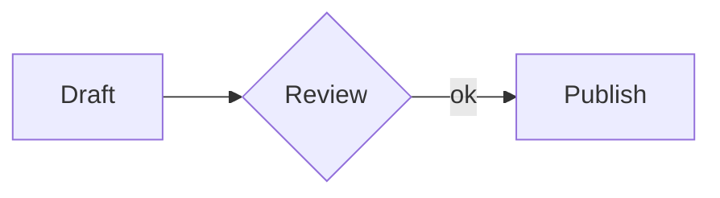
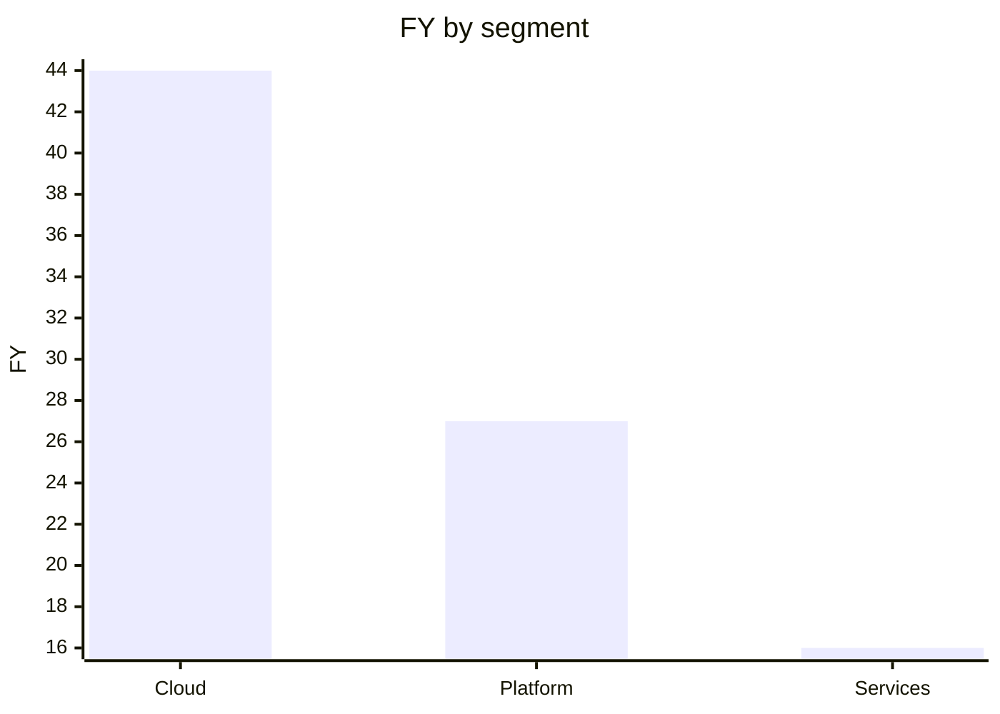

[](https://mcptoplist.com/server/io.github.geml-spec%2Fgeml) [](https://glama.ai/mcp/servers/geml-spec/geml) [](https://github.com/punkpeye/awesome-mcp-servers#knowledge--memory) [](https://github.com/hashgraph-online/awesome-ai-plugins#development--workflow) [](https://github.com/mundimark/awesome-markdown#beyond-markdown---lets-fix-markdown-quirks--oddities-and-lets-fill-in--add-the-missing-parts-tables-footnotes-generic-blocks-etc)


<p align="center">
  <picture>
    <source media="(prefers-color-scheme: dark)" srcset="docs/assets/logo/geml-logo-dark.svg">
    
  </picture>
</p>

# GEML — General Expressive Markup Language（通用表达型标记语言）
[](https://www.npmjs.com/package/@geml/geml) [](https://modelcontextprotocol.io) [](https://github.com/geml-spec/geml/actions/workflows/ci.yml) [](https://github.com/geml-spec/geml/actions/workflows/geml-check.yml) [](spec/GEML-spec_CN.md) [](LICENSE) [](spec/LICENSE-spec.md)

*[English](README.md) | 中文*

GEML 是一种**轻量级标记语言：块的形式统一、可寻址，配一套标准动词**。<br>
**人读着轻松，agent 改着安全。**
在 agent 驱动的软件开发与知识协作中，纯文本与 Markdown 缺乏确定性的区块边界：程序与模型交互时往往整篇读进来、整篇写回去，稍微好点的就定位靠行窗口反复试探，改写要把原文逐字复述一遍，Token 消耗随文档长度线性膨胀，操作变得臃肿。多轮改写之后，其他摘抄它的副本也开始失真。

**目录：**[它解决什么](#problems) · [需要什么样的格式](#why-now) · [GEML有何不同](#whats-different) ·
[1分钟学会](#one-minute) · [Profile扩展体系](#profiles) ·
[即刻上手试试](#hands-on) · [搭配大模型使用](#with-an-llm) ·
[生态成熟度](#maturity) · [设计思路](#challenge) · [路线图](#roadmap) · [参与我们](#contributing) · [许可](#license)

**你不需要改动任何东西就能开始。** `geml list`、`geml find`、`geml get` 直接对你现有的 Markdown 寻址——不做任何转换、不产生新文件，你的 `.md` 还是 `.md`：

```sh
geml list    README_CN.md                              # 每一节，都是一个地址
geml get     README_CN.md '#核心特性-key-features'        # 只读一节，而不是整个文件
geml set     README_CN.md '#核心特性-key-features' --body # 写回一节
geml replace README_CN.md '旧文本' '新文本'              # 替换字面串，并告知落在哪一块
geml history save README_CN.md -m '收紧开头'            # 存一个版本到文件旁的 README_CN.md.gemlhistory
```

进入 agent 上下文的只有那一节——一两 KB，而不是整个文件，不管它长到多大。而每次保存都是一个版本，可以读回来，也可以退回去——退一个块，或整份文件。

▶ **[到 Playground 试一下](https://geml-spec.github.io/playground/)**——无需安装，也不用先读任何东西。

要比“一节”更细——单个块、单张图、单张表——就让 `.geml` 站在中间层：在那个粒度上编辑，你 `--to md` 交付出来的永远不会与它漂移。

**块有自己的名字，块里的东西有自己的坐标。** 表里的一个单元格、`data` 块里的一个叶子、
`meta` 里的一个键——每一个的坐标都由结构本身给出，`get` 和 `set` 精确落在那个值上。

```sh
geml get doc.geml '#fy[2]["Q1"]'                     # 一个单元格
geml set doc.geml '#intake["fields"][1]["name"]'     # JSON 里的一个叶子
```

对人，它是清晰可读的纯文本；对 agent，它是可寻址、可校验、可溯源、可回退的**[“Doc-as-a-Base（文档即库）”](https://geml-spec.github.io/manifesto-cn)**。

---

**GEML 极简。**
它是纯文本，脱离渲染器依然清爽；
全语言只有一种块语法；
原生提供可寻址、可校验、可引用的结构化表达。

它不为每种内容单独设一套迷你语法，而是把所有类型内容都以一个类型块容器承载。代码是块，表格、图形、公式、提示框、乃至元数据，都是块；一段散文也可以成块（`=== text`），只要你想按 id 指到它。未来要扩展也简单至极。形态都一样，所以这门语言好学到很难写错。

块有名字，动词才有落点。完整语法见[1分钟学会](#one-minute)。

<a id="problems"></a>
## 它解决什么

### 背景与解决的问题 (Problems Solved)

1. **上下文负载与 Token 膨胀**：JSON/XML 包裹标签冗余，Markdown 缺乏结构化元数据与引用机制；GEML 只读写目标块，上下文占用不再随文档长度膨胀。
2. **AST 操作精度与解析确定性**：非结构化文本经多轮 LLM 读写后容易格式破坏、语义偏移；GEML 语法确定、直接映射为 AST，程序和 LLM 按块原子增删改查。
3. **文档副本碎片化**：多 Agent 协作、多流程共享靠复制粘贴，副本各自脱节；GEML 以**单一数据源**设计，用标准引用与数据绑定替代副本。

### 核心特性 (Key Features)

- **AST 级精准结构化操作**：文档直接解析为类型化文档树，Agent 精确定位后局部更新、幂等更新；写入以字节切片落地并整篇重校验，未触及的字节零改动。
- **低 Token 读写**：省下的不是标记字符，而是没读的那部分——按 `#id` 命中语义完整的一块，其余内容根本不进上下文。
- **单一数据源与模块化引用**：原生的跨文档、跨片段引用，源节点一改，引用端自动同步。
- **双向读写鲁棒性**：全语言只有一种块形态，生成侧易学难错；解析器给出明确的错误定位与修复反馈。
- **基于 Profile 的领域扩展**：在 `=== meta` 里声明 `profile` 扩展领域词汇（设计样式、交互表单、代码图谱、音视频轨），不发明新语法；声明了的词汇由各自的检查器校验，不认识的环境安全降级为标准块。

---

<a id="why-now"></a>
## 大模型需要什么样的文本格式？

AI 时代的文本，是“模型生产，人机共读”。

共读决定了可读性不可妥协；但大模型选择 Markdown，仅仅是旧时代没有更好选择时的妥协，而非终极答案。

一种真正面向人机协作的新一代文本格式，应当让机器的读写体验脱胎换骨：

- **微粒度**：精准按块寻址，块内按坐标，告别全文扫描；
- **强结构**：组织更有序，内容更灵活；
- **一致性**：读写接口规范，多模态天然扩展；
- **零门槛**：极低的心智负担，几乎零成本平滑迁移。

然而，我们现有的文本基础设施均非为此场景设计：

* **Markdown (为人排版)**：缺乏稳定的结构块与机器主键。Agent 哪怕只改一个参数，也必须读写整篇，不仅在多轮循环中**极度浪费上下文预算**，更极易引发文本格式与语义的漂移。
* **JSON / XML (为机器序列化)**：充斥着冗余的包裹语法与结构噪点，既阻断了人类的直观阅读，又在长上下文中白白消耗昂贵的 Token。
* **临时记忆与碎片文件 (缺乏单一真相源)**：上下文被拆散在对话历史与各处 Markdown 拷贝中，“副本自诞生就在漂移”，导致版本脱节与幻觉失真。

这三条的病根，恰恰是三者各自的优点：Markdown 的"永不报错、怎么写都行"成全了人的书写自由，也注定了机器无法信任它读到的结构；JSON/XML 的严格 schema 成全了机器的确定性，也注定了没人愿意在里面写散文。优点即病根，所以补丁修不动——给 Markdown 加上"坏引用必须报错"是对它契约的违背，给 JSON 剥掉包裹语法是对它本性的否定。当人与 agent 开始在同一份文本上高频协作，需要的不是两极之间的折中，而是把"人可读"与"机可操作"从第一天就写进同一条设计约束。

### 核心解法：**[“Doc-as-a-Base（文档即库）”](https://geml-spec.github.io/manifesto-cn)**

GEML 是一种新格式，但新瓶装的是旧酒：增强和统一Markdown式的表达，剥离HTML式复杂排版语法、围栏块思想来自 Markdown，`#id`和内嵌来自 XML 与 AsciiDoc，行内投影借鉴Obsidian，读写动词借鉴 Roy Fielding 博士提出的 **[REST](https://www.ics.uci.edu/~fielding/pubs/dissertation/rest_arch_style.htm)** 架构风格；新的只是把它们收进同一个块容器。有点像 TypeScript 之于 JavaScript：语法上做不到兼容，但 `list`、`get`、`set`、`add`、`delete` 这些操作已经能直接用在你现有的 Markdown 上。这个块容器为纯文本文档提供一组标准操作语义：

| 传统痛点 | GEML 对应能力 (四大定律) | 给开发者与 Agent 带来的实际价值 |
| :--- | :--- | :--- |
| **修改一处需全篇重写** | **寻址律 (Addressing)** | 给每个块赋予 `#id`，`get/set` 只读写目标块。**没被加载的东西不可能被改坏**，省下宝贵的上下文空间。 |
| **到处复制导致副本漂移** | **投射律 (Projection)** | `===embed`是动态求值而非复制粘贴，源头单一定义，彻底消除“同步多处副本”的无谓劳动。 |
| **坏格式/断引用污染下游** | **校验律 (Validation)** | 构建期自动核验引用与语法，**坏写入挡在落盘之前**，不等人工 review 介入拦截。 |
| **误改后只能全文件回滚** | **回退律 (Rollback)** | 伴生 `.gemlhistory` 支持**单块原子回退**，不推倒整篇，为 Agent 提供轻量级版本安全网。 |

> **文档需要的不再只是一个格式，而是一组动词。** GEML 让文档既保留纯文本的可读性，又具备确定性的块级操作能力。大模型时代工程文档的困境、为什么要把这些旧做法收进一个新的块容器，完整论证见博客文章[**《为什么大模型时代需要一种全新的文本格式？》**](https://geml-spec.github.io/blog/2026/08/03/why-do-we-need-a-new-text-format-in-the-era-of-llms_cn)。

---

<a id="whats-different"></a>
## GEML 有何不同？

上一章的四样能力——寻址、投射、校验、回退——各家格式分别落在哪，见下表；GEML 刻意做小，拒绝了什么见[设计思路](#challenge)。

### 与其它格式的比较

四样能力在各自领域都有成熟方案；不寻常的是把它们同时装进一种纯文本格式：

| 流派 | 状态本质 | 可寻址 / 可引用 | 可投射 / 引用嵌入 | 可校验 | 历史管理 / 可溯源 |
| :--- | :--- | :--- | :--- | :--- | :--- |
| **Word / Docs** | 状态黑盒 | ❌ 无块级主键，接入靠平台 API | ❌ 只能复制粘贴 | ❌ 无校验机制 | ⚠️ 依赖平台服务端，不在文件内 |
| **Markdown / AsciiDoc** | 字符串流 | ⚠️ 标题锚点或方言 id，无读写动词 | ⚠️ 方言嵌入（Obsidian `![[…]]`、`include::`），断链无声 | ❌ 死链无声失效 | ❌ 格式内没有，必须依赖外部 Git |
| **JSON / XML** | 数据序列化 | ✔️ (id / schema) | ⚠️ 仅 XML 有（XInclude，外置） | ✔️ 依赖外部工具链 | ❌ 格式内没有，必须依赖外部 Git |
| **GEML** | **纯文本 + 块结构** | **✔️ 每块独立 `#id`（原生可引用）** | **✔️ `=== embed` 引用即取值（原生嵌入）** | **✔️ 构建期强校验报错** | **✔️ `.gemlhistory` 紧邻文件（原生可溯源）** |

逐项对比：[对比 CommonMark](https://geml-spec.github.io/compare/commonmark-cn) · [对比 XML 与 JSON](https://geml-spec.github.io/compare/xml-and-json-cn) · [7 种格式能力矩阵](https://geml-spec.github.io/compare/matrix-cn) · [awesome-markdown 里的 Markdown 变体与工具](https://geml-spec.github.io/illustrated/geml-vs-markdown-variants_CN.html)（HTML 页面）。

与 Markdown 的共存方案：GEML 当作**编辑侧的事实源**，而 Markdown 作为交付物。用 `geml <file> --to md|html` 单向投影，交付照旧是 `.md` / `.html`。**只协同，不锁定。**（投影有损：块 id 与绑表图表不会跟过去。）

**别信这张表，自己跑一遍。** 我就这么问的大模型：

> 你基于 claude 你自己在前面编辑 README 等文档的经历，描述下你处理文档的命令过程步骤（我看用到了 grep 之类的），以及是否缓存文档，以节省 token，我们来对照下，基于这个看 geml 有哪些是能够派上用场的

得到这样的结果 **[单次编辑的成本](https://geml-spec.github.io/benchmarks/addressing-cost-cn)**和**[真实一天的回放](https://geml-spec.github.io/benchmarks/mixed-toolchain-cn)**，你也可以贴给你的大模型，看看他给你的答案是什么。
PS: 我还在试能不能用上geml的codemap生成的上游链（被调用链）和下游链（调用链）功能来快速精确定位函数、调用点和修改项目代码,到时候我来贴个报告。

<a id="one-minute"></a>
## 1分钟学会

### 类型块

**一种形态，通吃所有类型。** 块的基本语法是 `=== type [属性]` … `===`（属性如 `{#id .class key=val}` 为可选），变的只有 `type`（以及正文怎么读）：

```
=== code {lang=python}
print("hi")
===

=== note {.intro}
解析过的散文，可用 *强调* 与 [[#budget]] 引用。
===

=== meta
title = "Budget plan"
===
```

连续的 `=`（≥3 个）开块，等长的一串闭块；更长的围栏可嵌套更短的。带 `#id` 的块还可以用**带标签围栏** `=== #id` 闭合，不必数围栏长度，长块因此更难写错（嵌套仍须更长的外围栏：块体里等长的裸 `===` 会提前闭块，带不带标签都一样）。类型决定正文如何解读：`raw`（原样：`code`、`diagram`、`math`、`table`）、`flow`（带内联标记的散文：`note`、`text`）、或 `data`（每行一个 `key=val`：`meta`）；`embed` 则根本没有正文，`src=` 指名它所代表的那个块。每个块都可携带属性对象 `{#id .class key=val}`，其中 `.class` 是*语义*标签，绝不作样式钩子。完整的内联语法（强调、链接、`[[#id]]` 自动引用、媒体、脚注、行内 `$公式$`）见[规范](spec/GEML-spec_CN.md)。

### 表格 —— 两种正文，一个模型

可视化写法：

```
=== table {#budget caption="年度成本"}
| Plan  | Months | Rate |
|-------|-------:|-----:|
| Basic |      1 |   30 |
| Pro   |      2 |   30 |
===
```

……或写成数据。表格装事实，它之上的一个 **`view`** 派生出**计算列**与**汇总行**：

```
=== table {#fy25 format=csv header=1}
Segment,  Q1, Q2, Q3, Q4
Cloud,     8, 10, 12, 14
Platform,  5,  6,  7,  9
Services,  3,  4,  4,  5
===

=== view {#fy25-report src=#fy25 compute="FY [%.1f] = Q1 + Q2 + Q3 + Q4; n = 1" summary="Segment = 'Total'; FY [%.1f] = sum(FY); n = sum(n)"}
===
```

*两种表格形态描述同一个模型。`FY` 列与 `Total` 行由那个 view 在构建期算出：*

| Segment   | Q1 | Q2 | Q3 | Q4 |   FY | n |
|-----------|---:|---:|---:|---:|-----:|--:|
| Cloud     |  8 | 10 | 12 | 14 | 44.0 | 1 |
| Platform  |  5 |  6 |  7 |  9 | 27.0 | 1 |
| Services  |  3 |  4 |  4 |  5 | 16.0 | 1 |
| **Total** |    |    |    |    | **87.0** | **3** |

`compute` 对各列逐行做 `+ - * / ( )` 运算；`summary` 用聚合 `sum / avg / min / max / count`（并可对聚合结果再做算术，如加权比率）生成表尾一行；列名后的 `[printf]` 控制数字显示。上面的 `n` 就是数行数的写法 —— `count` 数的是某一列的非空单元格，所以对一个常量列求和才是数行。

表格还支持用 `src="regions.csv"` 引入外部 CSV。

### 公式

```
=== math {#gauss caption="高斯积分"}
\int_{-\infty}^{\infty} e^{-x^2} dx = \sqrt{\pi}
===
```

$$\int_{-\infty}^{\infty} e^{-x^2} dx = \sqrt{\pi}$$

### 图形与图表 —— 托管 DSL，或为表格作图

GEML 从不解释图形正文，而是把它交给可插拔渲染器（未知 `format` 仅告警，正文原样保留）：

```
=== diagram {#flow format=mermaid caption="评审流程"}
graph LR
  A[Draft] --> B{Review} -->|ok| C[Publish]
===
```



图形还能**为一张表作图**，单一真相，列引用在构建期受校验，数据零拷贝：

```
=== diagram {format=geml-chart data=#fy25-report type=bar x=Segment y=FY}
===
```

*取自上面的 `#fy25-report` view —— `FY` 是计算列，所以图表绑的是派生它的那个
view，而不是基表：*



### 数据 —— 存的是值，不是文字

每个块类型都在说明它装的是什么：`code` 装一段代码，`table` 装表格，`math` 装公式。`data` 装的是**数据值**，也是各种数据格式的归处——目前 `json`（默认）、`jsonl`，以及按声明子集读入的 `yaml`；`toml` 预留。带类型意味着正文会被**读进来**，而不只是展示出来：少一个逗号就构建失败，`geml get --json` 直接返回那个值，图表也能直接读它。

```
=== data {#log format=jsonl}
{"ts":"09:00","p95":41}
{"ts":"09:10","p95":58}
===
```

`jsonl` 正文一行一条记录，程序可以在文件尾盲追加。记录也可以留在自己的文件里：`src=ops/latency.jsonl#L900-999` 指明文件，并可选地指明一段行窗口——日志照旧被追加、`tail -f`，而文档是它**受校验、可寻址、可作图的那个视图**。

### 内嵌 —— 动态引用，不复制

一个块可以代表另一个块：同文档用 `src=#id`，跨文档用 `src=other.geml#id`。内嵌是渲染时对源头的**动态取值**——源头一改，所有内嵌处跟着变；源头没了，`geml check` 让构建当场变红。

```
=== embed {src=#fy25}
===
```

正文保持为空，目标写在 `src=` 里。
 
Markdown 里看不到投影效果。想亲眼看：装上[浏览器扩展](https://chromewebstore.google.com/detail/opmhfphgoidpnipphfgkhhjhmnmaenie)，打开 [sample.geml 的 raw 链接](https://raw.githubusercontent.com/geml-spec/geml-spec.github.io/main/public/playground/sample.geml)，翻到 **Transclusion** 一节——同文档投影（`src=#roadmap`）、跨文档投影、乃至跨文件链式解析（embed 引一张图，图又绑另一文件里的表）都在就地渲染：那里一个字都没写，改源头一处，投影处即变。
 
<a id="profiles"></a>
## Profile —— 领域词汇扩展，像搭乐高一样组合文档能力

想在文档里写交互表单、管理设计系统，或是嵌入整个代码库的调用图？
在传统 Markdown 里，这意味着各家私造插件（`:::note`、自定义 JSX 标签），最终沦为互不兼容的方言地狱。

GEML 的解法是 **Profile（应用层词汇表，规范 §8.6）**：**一行声明，按需给文档接入专业领域的结构化能力。**

```geml
=== meta
profile = "geml-style/v1 geml-form/v1"
===

==== form {#signup handler=subscribe}
=== form-field {name=email label="工作邮箱" type=text required pattern="[^@]+@acme\\.com"}
===
====

=== style-rule {#cta match="button.cta" bg="{{brand}}" radius="6px"}
===
```

### 扩展而不割裂

- 🧩 **像搭乐高一样按需混搭 (Mix & Match)**：核心语法保持精简、冻结，领域能力在它旁边扩展；代码图谱、样式系统、表单约束、版本回退……一行 `profile = "..."` 即可组合多个专业领域的表达能力。
- ⚡ **无需编写插件，直接用上整套工具链**：定义新的领域块**不需要开发解析器或写插件**，扩展块和其他块一样，天然具备稳定的 `#id` 寻址、`geml get/set` 局部读写、CLI 动词、MCP 协议以及 AI Agent 的精准操控。
- 🛡️ **天然可移植，永不锁死 (Never Fractured)**：扩展了能力，却不破坏文档的通用性；不认识某个 profile 的处理器照样能读出每一个块、按 `#id` 寻址，文档换个工具也保持原有结构。

### 官方已落地的 Profile 矩阵

| Profile（使用指南） | 状态 | 用来做什么 | 专属 CLI | 在线演示 / 示例 |
| :--- | :--- | :--- | :--- | :--- |
| [`geml-codemap/v1`](spec/profiles/geml-codemap/geml-codemap-guide_CN.md) | stable | 把代码库的调用图生成为一组 GEML 文档：每个方法一个块，能查谁调用它、它又调用了谁；前后端合成同一张图 | `geml codemap build\|verify\|serve` | [可交互的调用图](https://geml-spec.github.io/demos/codemap) |
| [`geml-media/v1`](spec/profiles/geml-media/geml-media-guide_CN.md) | draft | 用一份文档描述一条视频时间轴：素材、片段、字幕和配音轨道；可导出成网页播放，或用 ffmpeg 出成片 | `geml media build\|export\|lay\|todo` | [文档出视频（经 ffmpeg 出 MP4）](https://github.com/geml-spec/geml-spec.github.io/blob/main/public/examples/geml-media-demo/README.md) |
| [`geml-style/v1`](spec/profiles/geml-style/geml-style-guide_CN.md) | draft | 颜色、间距、布局写在单独的样式文档里，按规则作用到内容文档上，内容文档本身不用改 | `geml style check` | [GitHub blob 页 1:1 复刻](https://github.com/geml-spec/geml-spec.github.io/blob/main/public/examples/style-demo/) |
| [`geml-history/v1`](spec/profiles/geml-history/geml-history-guide_CN.md) | stable | 在文档旁边的 `.gemlhistory` 里保存历史版本：能查看任意旧版、只退回某一个块，或整份回滚 | `geml history save\|get\|restore` | [单块回退的常用操作](spec/profiles/geml-history/geml-history-guide_CN.md#常用) |
| [`geml-form/v1`](spec/profiles/geml-form/geml-form-guide_CN.md) | draft | 在文档里描述表单：有哪些字段、什么类型、是否必填、取值范围；浏览器扩展和 playground 会画出表单预览 | — | [可交互的复杂表单示例](spec/proposals/0008-form-block-example/) |
| [`geml-translator/v1`](spec/profiles/geml-translator/geml-translator-guide_CN.md) | draft | 译文文档里不放译文，只引用原文并写明目标语言，打开时由浏览器扩展现场机翻；原文改了，译文跟着变 | — | [打开即译](https://geml-spec.github.io/demos/translate) |
| [`geml-statechart/v1`](spec/profiles/geml-statechart/geml-statechart-guide_CN.md) | draft | 用一个 `diagram` 块写状态机：状态、带守卫和动作的转移、守卫读的变量；`geml check` 找出到不了的状态和死路，`--to html` 画出来，`--to md` 转成 Mermaid | — | — |

> 💡 **想看 Profile 实际跑起来？**
> • **`geml-media` 在线演示**：一份剪辑文档加一条命令（`geml media build ep01-cut.geml --out ep01.mp4 --burn-subs`），由 ffmpeg 对齐音视频、混音、烧录字幕，直接出成片（[去看](https://geml-spec.github.io/demos/media-cut)）。
> • **`geml-style` 在线演示**：内容留在 `page.geml` 里的纯文本，样式和布局放在 `github.style.geml`——渲染出 GitHub blob 页像素级 1:1 的复刻，不被任何 CSS 锁死（[去看](https://geml-spec.github.io/demos/style)）。
> • **表里每个 profile 名都链接到它的一页使用指南**：它做什么、第一条命令、常用操作。写代码的话，从 `geml-codemap` 开始。开发者也可以按规范轻松[定制自己的专属业务 Profile](spec/profiles/README.md)。

<a id="hands-on"></a>
## 下一步——即刻上手试试

▶ **[到 Playground 试写 GEML](https://geml-spec.github.io/playground/)**——左边编辑、右边实时渲染；七个章节从类型块、`#id` 讲到坐标、数据、图表与投影，写坏了当场报错。无需安装，也不用先读任何东西。

然后按你顺手的次序：

1. **在浏览器里看它渲染。** 装上**[浏览器扩展](https://chromewebstore.google.com/detail/opmhfphgoidpnipphfgkhhjhmnmaenie)**，打开任一 raw `.geml` 链接*（要 raw 文件本身，不是 GitHub 的 blob 页面，那个是 HTML）*：**[GEML 规范本身](https://raw.githubusercontent.com/geml-spec/geml/main/spec/in_geml_format/GEML-spec.geml)**（dogfood，规范本身就是一份 GEML，规模化渲染）、**[showcase](https://raw.githubusercontent.com/geml-spec/geml-spec.github.io/main/public/examples/showcase.geml)**（计算表、四张图、一条 Mermaid 流程、公式），或 **[playground/sample.geml](https://raw.githubusercontent.com/geml-spec/geml-spec.github.io/main/public/playground/sample.geml)** 看交互式代码图。
2. **看一份文档怎么排成一整页。** [样式演示](https://geml-spec.github.io/demos/style) 是 GitHub blob 页的 1:1 复刻——顶栏、文件树、面包屑、Preview/Code/Blame、下拉菜单——每一个字在 `page.geml`，每一个颜色和尺寸在 `github.style.geml`，而 viewer 两边都不认识。任何浏览器点开就能看——页面由 viewer 自己的代码画出来——生成它的 GEML 就在下面。
3. **在本地跑起来。** `npm i -g @geml/geml`（Node 22+），然后 `geml check` 一份文档，或对着你自己的仓库跑 `geml codemap build`；用 Claude Code 的话，`npx -y @geml/geml skill install` 一条命令把写作技能、CLI、MCP server 装到用户全局，不改任何设置、不装 hook（[详情](#with-an-llm)）。
4. **读语法，或看逐条图解。** **[完整规范](spec/GEML-spec_CN.md)**（中 / [English](spec/GEML-spec.md)）是规范性文本，短到可以一口气读完；**[GEML 图解](https://geml-spec.github.io/demos#illustrated-syntax)**（中英两版）是 11 页自包含页面，每个块类型、每个 profile、以及 CLI 各一页：左边是 GEML，右边是处理器**实际**做了什么（`geml check` 诊断、`geml list` 地址、`--to html` 标记），每条规则都标了出处与状态。

<a id="with-an-llm"></a>
## 配合大模型与 agent 使用 GEML

目标只有一个：让你的模型**一次只改一个块，改完就校验**——而不是为改一段话重读、重发
整篇文档。做到它只需一步：

| 你用的是 | 运行 |
| :--- | :--- |
| **Claude Code、Gemini、Qwen** | `npx -y @geml/geml skill install`——写作技能、CLI、MCP server 一次装到用户全局；不改 `settings.json`，不装 hook *（偏好插件：`claude plugin marketplace add geml-spec/geml`，再 `/plugin install geml@geml`）* |
| **Codex** | 在本仓库的检出目录里启动，插件就在 `/plugins` 里；不克隆的装法见 [integrations/codex-plugin/](integrations/codex-plugin/) |
| **DeepSeek Harness** | `dsh plugin --profile web add @geml/dsh-plugin`（[源码](integrations/dsh-plugin/)） |
| **任何 MCP 客户端** | `npx -y @geml/geml mcp --root .`，或什么都不装，直接用 `https://geml-mcp.supermarket.workers.dev/mcp`——Cursor、VS Code、Claude Desktop 的配置见 [docs/mcp-guide_CN.md](docs/mcp-guide_CN.md) |

**用别的大模型**——读不到技能的模型，需要你把规则给它一次。把下面这段贴过去，并让
`geml check` 守住它写回来的东西（CLI 装法是 `npm i -g @geml/geml`，需 Node 22+）：

> 把文档写成 GEML：每个块都是 `=== type [属性]` … `===`（类型见
> [1分钟学会](#one-minute)）。模型最容易写错的是这四条：闭合围栏必须是与开围栏
> **等长**的一串 `=`，正文里含 `===` 就得用更长的外围栏；标题只用 ATX `#`，没有 `---`
> frontmatter（元数据用 `=== meta`）；每个 `#id` 唯一，且每个引用（`[[#id]]`、
> `[text](#id)`、`[^id]`、`data=#id`）都必须能解析；不允许 raw HTML。规范见
> [`GEML-spec_CN.md`](spec/GEML-spec_CN.md)。

### 它会怎么用

```sh
geml list   doc.geml                                     # 先调它：每个块的地址、种类、行范围
geml find   "关键词" doc.geml                             # 搜块内容 → 地址（不是行号）
geml get    doc.geml '#hello'                            # 读取单个块（标题 id = 整节）
geml get    doc.geml '#hello' --intro                    # 一节切三段：--head | --intro | --body
geml set    doc.geml '#license' --in template.geml#mit   # 替换这个块，从另一文件 fork 内容
geml add    doc.geml --after '#intro' --in snippet.geml  # 插入片段（保留其自身 id）
geml revert doc.geml '#plan' --rev -1                    # 把单个块回退一版
geml check  doc.geml                                     # 只校验：诊断 + 退出码
```

经 MCP 时，这些动词就是工具（`geml set` → `geml_set`）。比让模型直接重写文件多两重保证：
写入**落盘前**先解析，会弄坏文档就拒写；每次写入前先记一版 `.gemlhistory`，所以 `geml_revert`
能撤回单个块。路径限定在 `--root` 内；根目录里有代码图时，还能回答「谁调用了它」。
全部动词见 [parser README](geml-parser/README.md)，全部工具见 [docs/mcp-guide_CN.md](docs/mcp-guide_CN.md)。

<a id="maturity"></a>
## 生态成熟度

- **规范 `1.0` 已稳定**，有[中文](spec/GEML-spec_CN.md)和[英文](spec/GEML-spec.md)版，本身也
  [用 GEML 写成](spec/in_geml_format/GEML-spec.geml)。[MIME媒体类型](https://www.iana.org/assignments/media-types/media-types.xhtml)
  [`text/vnd.geml`](https://www.iana.org/assignments/media-types/text/vnd.geml) 已在 IANA 注册。
- **两个实现**通过同一套 800+ 条用例的[一致性测试集](geml-parser/test/conformance/)：参考实现
  [`geml-parser/`](geml-parser/)（TypeScript，2,300+ 项单元测试，覆盖率卡在 95%）和
  [`geml-parser-rs/`](geml-parser-rs/)（Rust 与 WebAssembly，只依据规范与测试集写成）。
- **前向兼容写在语法里**：处理器遇到不认识的构造必须优雅降级（§8.2），所以新增块类型不算破坏性
  变更。各版本见 [`CHANGELOG.md`](CHANGELOG.md)。

<a id="challenge"></a>
## 设计时我们怎么想的

### 设计遵循什么

1. **人机同构，而非两极折中 (Human-Agent Isomorphism)**：不在「人读的 Markdown」和「机器读的 JSON」之间折中，而把「人可直读」与「机器可确定性操作」当作同一条硬约束——人看到清爽的排版，Agent 拿到强类型的 AST。
2. **文档即库，而非字符流 (Doc-as-a-Base)**：文档是由结构化记录与稳定主键（`#id`）构成的库，每个区块有独立的生命周期、坐标与原子级 CRUD 接口，Agent 按块精准读写，不再改一处就整篇重写。
3. **单一语法原语，词汇开放扩展 (One Primitive, Open Vocabularies)**：只用一种**类型块（Typed Block）原语**承载代码、数据、图表、计算与排版；领域词汇通过 **Profile 机制**扩展，语法保持冻结、词汇保持开放，从根源上避免各自发明方言造成割裂。
4. **消除复制动机，而非仅修补死链 (Transclusion over Duplication)**：超链接只是路标，诱人复制粘贴、副本漂移；GEML 的引用是动态视窗（`=== embed`），一处定义，处处实时投影。
5. **像对待代码一样对待文档 (Compiler-Grade Integrity)**：Markdown 永不报错、凑合渲染；GEML 在构建期严格校验，断掉的 `#id`、成环的引用直接以非零退出码拦下，坏数据不留给下游。
6. **以伴生历史捍卫 Local-First，而非云端锁定 (Local-First History over Cloud Lock-in)**：版本的粒度在区块，历史放在文档旁的 `.gemlhistory` 里，不依赖云端服务，也不为微小改动走整库 Git 提交；`geml revert doc.geml '#id'` 单块回退。

### 于是拒绝了这些

| 拒绝的 | 为什么 |
|---|---|
| 自创图形语言 | 托管外部 DSL（Mermaid、Graphviz、D2…），格式只定义托管协议 |
| raw-HTML 逃生舱 | 语义保持可移植，不绑定任何后端或渲染器 |
| setext 标题 / `---` frontmatter | 只用 ATX `#`，消除与分隔线的歧义 |
| 复杂电子表格引擎 | 逐行公式与汇总够用；没有单元格寻址、查表、宏 |

<a id="roadmap"></a>
## 路线图

- [x] 规范与实现：GEML `1.0` 规范（中英双语，配一致性测试集与定义 `.gemlhistory` 的 `geml-history/v1` profile）；参考实现 `@geml/geml`（解析器、CLI、块级 `.gemlhistory` 追踪）；第二个实现 [`geml-parser-rs/`](geml-parser-rs/)——Rust 编写、编译为 WebAssembly，只依据规范与一致性测试集写成，没有读过参考解析器的代码
- [x] [MIME媒体类型](https://www.iana.org/assignments/media-types/media-types.xhtml) `text/vnd.geml` [已在 IANA 注册](https://www.iana.org/assignments/media-types/text/vnd.geml)（2026-10-26），以规范为已发布规范文件、以本项目为变更控制方
- [x] 工具：官方 MCP server（`geml mcp`，接入 Claude Code / Cursor / Codex 等支持 MCP 的环境）；codemap，把整个代码库的调用图写成 GEML；VS Code 插件已上架 Visual Studio Marketplace（publisher `geml`）
- [x] 生态集成：VS Code 语法高亮与引用检查、tree-sitter、Obsidian、Logseq（对活的 DB graph 双向同步）、浏览器 viewer、GitHub Action、LangChain / LlamaIndex，以及 agent 宿主插件——Claude Code、Codex、Grok、DeepSeek Harness，外加 Gemini CLI 与 Kimi Code 两份根清单
- [ ] Logseq 插件上架 Logseq 市场（[PR #893](https://github.com/logseq/marketplace/pull/893)）、Grok 插件上架 `xai-org/plugin-marketplace`
- [ ] 他人写的实现——任何你顺手的语言；规范与一致性测试集都是公开的，我们乐意帮着对齐

---

<a id="integrations"></a>
## 在哪能用

命令行 [`@geml/geml`](https://www.npmjs.com/package/@geml/geml) · 浏览器 [Chrome 扩展](https://chromewebstore.google.com/detail/opmhfphgoidpnipphfgkhhjhmnmaenie) · [VS Code](https://marketplace.visualstudio.com/items?itemName=geml.geml) · [IntelliJ / Android Studio](integrations/intellij+androidstudio-plugin/)（需自行构建）· [GitHub Action](integrations/geml-check-action/) · [LangChain / LlamaIndex](integrations/langchain+llamaindex/)（参考实现）· 免安装的 [Playground](https://geml-spec.github.io/playground/)。

<a id="contributing"></a>
## 参与我们

`1.0` 是指已有规则不会在你脚下变动，不是设计已经定死；目前两个实现出自同一位作者。

- **用你的语言写一个解析器**——[怎么写](docs/WRITING-A-PARSER_CN.md)；找出规范里含糊的地方，本身就是贡献。
- **来争论草案**——[GEP-0008](spec/proposals/0008-form-block.md) 和
  [GEP-0010](spec/proposals/0010-language-projections.md)，或者
  [发起一个讨论](https://github.com/geml-spec/geml/discussions/new/choose)。
- **认领一块**——还空着的事和仓库结构都在 [`CONTRIBUTING.md`](CONTRIBUTING.md)。

<a id="license"></a>
## 许可与治理

代码为 MIT（[`LICENSE`](LICENSE)）；规范文档为 CC-BY-4.0（[`spec/LICENSE-spec.md`](spec/LICENSE-spec.md)
逐份列明）。任何人都可以不经许可构建兼容实现；决策方式和名字的使用见 [`GOVERNANCE.md`](GOVERNANCE.md)。
