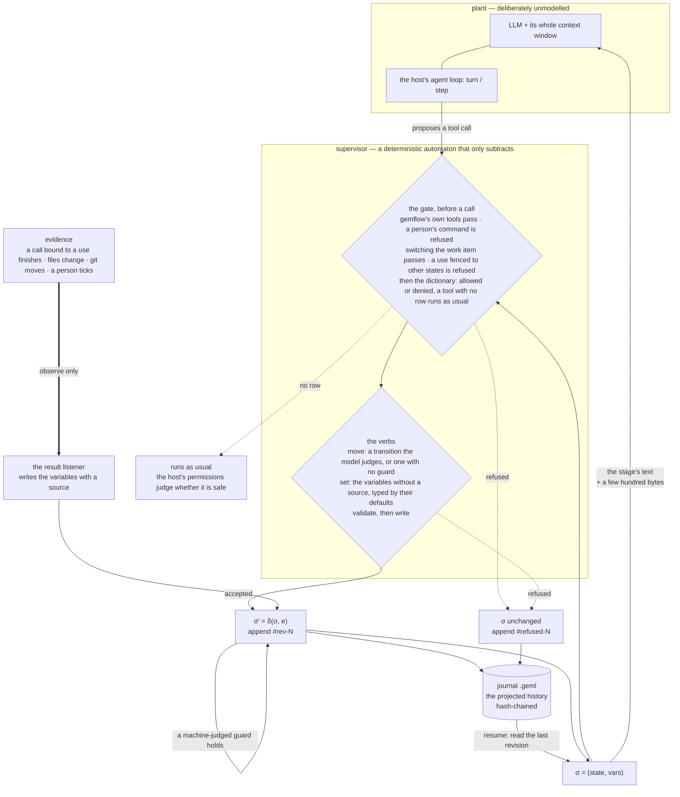

# @geml/gemflow — a supervisor for coding agents

English | [中文](README.zh.md)

A **workflow written in GEML** — one statechart — decides, at every moment,
which transitions an agent may take, which variables it may write, and which
tools belong to the stage it is in. A state declares **uses** (`edit`, `test`,
`deploy-prod`: words the author picks); a **tool dictionary** beside the
workflow binds each use to this project's tools, and a use is usable only in the
states that declare it. **Evidence** — a test's exit status, a pull request,
a file on disk, a person's tick — is written from what the host observed, never
from the model's word. Every change is validated before it lands and appended
to a **hash-chained journal** — itself an ordinary GEML document you can read,
address, diff and verify.

This is not a model of the agent. It is a **supervisor** in the
Ramadge–Wonham sense: the agent (an LLM plus its whole context) is the plant,
left unmodelled; the supervisor runs beside it and only ever *removes* events
from what may happen next. What it buys you is a safety property — certain
action sequences cannot occur — not convergence, and not a prediction of what
the model will do.



Only the mechanism is the host's; every decision above is one module
(`src/core/supervisor.ts`) that no host has a copy of — on Claude Code it runs
in the bundled CLI, which the plugin asks over a bridge:

| | DeepSeek Harness | pi agent | Claude Code |
|---|---|---|---|
| the gate before a call | `tools/pre-execute`: allow, or deny with the reason | `tool_call` → `{ block, reason }`, or nothing | a `tool.call` hook: the fast path decides from the policy it holds, the CLI judges and records over the bridge; the preferred-tool question goes to the person with `$.ui.ask`, the answer into `tools.geml`, and the dictionary's default parameters fill in what the call left out |
| the verbs' shape | `move` and `set` are re-registered per state: `move`'s enum is the transitions the model may take, `set`'s parameters the variables it may write; `status` is always there | registered once per session: `move`'s enum is every target in the workflow; a move that is not a transition out of the state is refused and recorded | static schemas (`to` is any string); a move that is not a transition out is refused |
| a person's transition | the board in the web GUI, a tab in the right sidebar: a person's transition — one marked `approval` included — a tick, a hold; the session's journal is not the CLI's, so `gemflow advance` in a terminal does not reach it | not yet: a session's journal is not the CLI's, so a transition marked `approval` has no one to take it there | the board, or `gemflow advance` in a terminal; `gemflow mark` ticks a variable whose source is a person |
| evidence | `tool`, from `tools/result`: a command's exit status when the result reports one, else 1 for an error and 0 for a clean result | `tool`, from `tool_result`: an error reads as exit 1, a clean result as 0 | `tool`, `file`, `git` and `human`, through the workspace |
| σ reaches the model | a prompt section + a per-step context block | the system prompt, rebuilt once per user turn | the new `#current` on the result of the call that moved the stage, else on the next prompt |
| the journal | `<journalDir>/<session>.geml` | the same file, plus one session entry per block — which is what makes a forked session inherit the chain | `.geml/journals/<item>.geml`, one per work item, shared with the CLI |
| `.geml/context.geml` | not written | not written | written |

The supervisor's state is `σ = (state, vars)`, and the allowed set is one line:

> `A(σ)` = every tool but those bound to a use this state does not declare and
> those the dictionary denies in this state, ⋃ the transitions out whose guard
> the model judges or that have none, ⋃ the variables without a source.

A tool bound to a use this state does not declare is refused, and so is one the
dictionary denies in this state; every other tool runs as usual.

## Status

| | |
|---|---|
| Shipping now | The workflow format, on `geml-statechart/v1` (no vocabulary of its own); the core library (workflow loading and static checks, the tool dictionary, evidence by source, hash-chained revisions, journal render/read/verify, the supervisor, Stagehand, work items, the backlog table); the workspace, which runs one locked operation at a time against a project; the `gemflow` CLI; four bundled workflows (`coding`, `dev`, `matter`, `video`), each with its dictionary; a Claude Code plugin (the band above the prompt, the board, `/gemflow`, the three tools `status`, `move`, `set`); `gemflow mcp` for hosts that speak only MCP; and both host adapters — a Cordis plugin for DeepSeek Harness `0.1.5-rc.1` with the board as a tab in its web GUI, and an extension for pi agent `0.85.x`. |
| Tested without a model | Every gate, on both adapter hosts: the DSH adapter against a real agent from `dsh-agent-loop-testkit`, the pi agent adapter against a double that runs its own pipeline order and its own argument validator. The Claude Code plugin: its hooks module under `claude plugin test`, in real event order, with a scripted bridge; the bridge through the bundled CLI in throwaway git repositories, with a stand-in for `gh`; the fast path held to what the workspace would refuse, record and ask about. A run against a live model is a manual step, below. |
| Not on every host yet | Evidence from files, git and a person, and the stage's context document (`.geml/context.geml`), run through the workspace. The Claude Code plugin hands it every tool call, and so do Codex's hooks once trusted, so all four sources are read there. On MCP-only hosts (`gemflow mcp`: Gemini CLI, Grok, Codex with its hooks untrusted, …) no tool call is seen: `tool` evidence is never written, nothing is refused, and `status` reads git and the file variables afresh when the model calls it. The two host adapters keep one journal per session and write `tool` evidence only; a transition marked `approval` has no one to take it there yet. |
| Not yet measured | What re-registering `move` and `set` per state costs DeepSeek Harness's prompt cache. |
| Also in this bundle | The GEML MCP server and four skills — authoring, code-graph, gemflow and split-session (see [Install](#install)). |

Design: [`docs/design/specs/2026-10-11-gemflow-design.md`](docs/design/specs/2026-10-11-gemflow-design.md).
The workflow format and runtime rules: [`spec/workflow.md`](spec/workflow.md);
the statechart format: [`spec/profiles/geml-statechart/`](../../spec/profiles/geml-statechart/geml-statechart-profile.md).

## A workflow

This is the workflow `gemflow init` writes, abridged — the one that governs a
coding session. A workflow is one `diagram` block whose body is a statechart:

```geml
=== meta
title   = "Coding workflow"
profile = "geml-statechart/v1"
===

=== diagram {#flow format=geml-statechart caption="Coding workflow"}
{
  "initial": "explore",
  "states": {
    "explore":   { "title": "Explore",   "description": "Read the code before proposing anything; record goal and touched, then move to plan.", "prompt": "#explore" },
    "plan":      { "title": "Plan",      "description": "Write the plan down before touching a file.", "prompt": "#plan" },
    "implement": { "title": "Implement", "description": "Make the change. Editing is possible here and nowhere else.", "prompt": "#implement", "tools": ["edit"] },
    "verify":    { "title": "Verify",    "description": "Run the command; its exit status is the evidence.", "prompt": "#verify", "tools": ["test"] },
    "review":    { "title": "Review",    "description": "Hand back to the person.", "prompt": "#review" },
    "done":      { "title": "Done", "final": true }
  },
  "vars": {
    "goal":       { "default": "", "note": "What this change is supposed to achieve, in one sentence" },
    "touched":    { "default": "", "note": "The files this change edits, space separated" },
    "plan":       { "default": "", "note": "The steps, written before any file is touched" },
    "command":    { "default": "", "note": "The command that decides whether this works, e.g. npm test" },
    "tests-pass": { "default": false, "source": { "tool": "test" } }
  },
  "transitions": [
    { "from": "explore",   "to": "plan",      "guard": "goal and touched are recorded" },
    { "from": "plan",      "to": "implement", "guard": "plan and command are recorded" },
    { "from": "implement", "to": "verify",    "note": "The edit is made; go run the command." },
    { "from": "verify",    "to": "implement", "guard": "the command failed, or the change is not finished", "actions": [{ "reset": ["tests-pass"] }] },
    { "from": "verify",    "to": "review",    "guard": { "properties": { "tests-pass": { "const": true } } } },
    { "from": "review",    "to": "done",      "approval": true },
    { "from": "review",    "to": "implement", "guard": "the person asked for changes", "actions": [{ "reset": ["tests-pass"] }] }
  ]
}
===

## Explore {#explore}

Read the code before proposing anything. …
```

and the project's `.geml/tools.geml` — the dictionary that binds the uses to
this project's tools, one for all its workflows:

```geml
=== table {#tools}
| tool             | for  | allow | deny | default | params |
|------------------|------|-------|------|---------|--------|
| Read             |      | *     |      |         |        |
| Grep             |      | *     |      |         |        |
| Edit             | edit |       |      | yes     |        |
| Write            | edit |       |      |         |        |
| Bash(npm test)   | test |       |      | yes     |        |
| Bash(cargo test) | test |       |      |         |        |
===
```

The states run `#explore → #plan → #implement → #verify → #review → #done`.
Three kinds of guard, three judges: an object over the variables (a JSON
Schema subset) is the machine's, and such a transition is taken on its own the
moment its guard holds — `tests-pass` written true takes `#verify` to
`#review`; a sentence is the model's, taken with `move` when the model judges
it true; `approval: true` is a person's, taken on the board or with
`gemflow advance`, never by the model. A guard holds whoever moves the
workflow. A variable with a `source` is evidence: `tests-pass` is written from
the exit status of a call bound to the use `test`, and `set` refuses it. A
variable without one is the model's to `set`, typed by its default.
`{ "elapsed": "PT2H" }` reads the clock: true once the stage has been held
that long, so a guard on it is a timeout. `done`
is marked `final`: a work item that enters it is closed — no transition out,
no evidence expiring — and a person's `gemflow rollback` reopens it.

A use is usable only in the states that declare it. `#implement` declares
`edit`, so `Edit` and `Write` run there and are refused everywhere else
(`Write is edit, which is used only in #implement; the workflow is in
#explore`); `#verify` declares `test`, so `npm test` runs there and nowhere
else. A tool the dictionary has no row for runs as usual. On a Rust project the same workflow binds `test`
to `cargo test` and changes nothing else. None of that is a rule in a prompt
the model may forget or argue with: the call is refused before it runs, and the
refusal is in the journal.

`geml check` validates the document like any other GEML; `gemflow check` adds
the statechart's own checks and the workflow's (`flow-*`), and reads the
dictionary against it. `geml get .geml/workflows/coding.geml '#flow'`
reads the block; `geml … --to md` projects it to a Mermaid state diagram that
GitHub renders, and the HTML renderer and the viewer draw it; `.gemlhistory`
versions it.

`gemflow init` writes the full version into `.geml/workflows/coding.geml` and makes
it the active workflow; `--template dev` writes the branch-to-production
workflow of [The dev workflow](#the-dev-workflow), `--template video` the
episode workflow of [The video workflow](#the-video-workflow).

## What it does not do

It constrains only the part of the world it models. None of these is an
oversight:

- **A rollback restores declared variables and the control state, never an
  external side effect.** The journal can set `approved` back to `false`; it
  cannot un-send a refund. Compensation is the workflow author's to write.
- **Tool gating is not a sandbox.** It decides which tools the model may call
  in a state; what an allowed `bash` then does is the harness sandbox's
  business. The two layers are complementary.
- **The dictionary reads the line, not what it does.** A `Bash(…)` key is a
  pattern over the command line: a deploy run through a launcher the dictionary
  has no row for, a variable or a script gets past it, and a `--dry-run` deploy
  counts as the deploy it spells. Write the rows your project runs.
- **Resuming restores the state, not the conversation.** A few hundred bytes
  bring back where the run is and what may happen next; the transcript is
  replayed by the harness under its own rules.
- **A gate is only as strong as the host's weakest mechanism for it**, and the
  table above says which. On pi agent `move`'s enum names every target in the
  workflow rather than only the transitions out of `σ`, because a pi agent tool
  cannot be re-registered mid-session; the move is still refused, one step
  later, and recorded.

The fit is therefore **whatever has an enumerable order**, which is not the
same as work whose *content* is enumerable. Approvals, KYC and ticket triage
are the easy case: the steps themselves are known in advance.

Writing code is the interesting one. What the agent will write is not
enumerable and should not be — but the **phases** are: you read before you
plan, plan before you edit, and run the tests before you claim they pass. The
shipped coding workflow models exactly that and nothing finer. A state per file
or per function would be the failure mode: it spends the model's judgement on
paperwork and buys nothing, because the order of those steps carries no
meaning. If a step's position in the order does not matter, it does not deserve
a state.

## Project layout

```
.geml/                          in the main checkout: every worktree of the repository reads the same
  workflows/<name>.geml         a workflow: one statechart block, each stage's prompt after it
  tools.geml                    the tool dictionary of all the workflows: which tool is which use, where a tool is allowed or denied
  project.geml                  the project document: meta flow-workflow names the default workflow; #items, every work item and where it ended up
  artifacts.geml                what each work item made: links, documents it changed in git, files git does not keep — where each is, which version
  artifacts/                    copies of the files git does not keep, named by their content's hash
  journals/<item>.geml          one journal per work item: a branch, or one file of a set
  sessions/                     the project's session record, every host's sessions
  exports/                      what the board exports
  .gitignore                    gemflow's own files, written by gemflow init: none of them goes into git
.geml/                          in each checkout
  context.geml                  the current stage's text and the variables, written again on each change of stage
  backlog.geml                  the backlog table
```

A project laid out the earlier way — a directory per workflow (`flow.geml`,
`guide.geml`, `tools.geml`) and `.geml/gemflow.geml`, in the checkout — is
still read. A Claude Code session's first status, or `gemflow migrate`, moves
it into the main checkout: each directory becomes one file with its guide's
sections in it, its rows join `.geml/tools.geml`, and `gemflow.geml` becomes
`project.geml`. What git tracks is copied and left where it is, for you to
`git rm`; the rest goes to `~/.gemflow/trash/`. A journal started under an
earlier `flow.geml` goes on under the file it moved to.

`gemflow init` writes the project document:

```geml
=== meta
title         = "Gemflow"
flow-workflow = "coding"
===
```

Below it gemflow keeps a table, `#items`: every work item the project has had
and where it ended up, read off git each time the board lists them —
`doing` while its branch is there and not merged; `merged` once main holds
its commits or its pull request is merged, the branch or its worktree still
there; `closed` once that is gone; `dropped` for a branch deleted unmerged, or
with no commit at all. A work item that is a file is closed at its flow's
final state and dropped at `parked`. The table remembers what git forgets — a
deleted branch's last tip and how many commits it had — and only it is
rewritten: what you write around it stays.

What a work item made goes into the `#artifacts` table of `artifacts.geml`,
one row a version. Of the files the work item wrote, the ones git does not keep
are looked at once at the end of each turn and once when the board opens: when
the content changed, a copy goes into `artifacts/`; a file over 20 MB is kept
by where it is and its hash. A GEML document keeps one copy, its later versions
in that copy's `.gemlhistory`. A document git keeps is recorded by its path
and the last commit that changed it. A page the Artifact tool published is
recorded as a link on its own; other links and generated pictures the model
records with the `artifact` tool.

The default workflow is the file `GEMFLOW_STATECHART` names (a path relative
to the project root), else the one `flow-workflow` names, else the project's
only workflow. The CLI, the Claude Code plugin, `gemflow mcp`, the DeepSeek
Harness adapter and the pi agent adapter resolve it the same way. Commit the
backlog; gemflow's own files stay out of git.

## CLI

```
usage: gemflow <check|snapshot|verify|export|init|use|migrate|status|mark|unmark|advance|pause|resume|rollback|run|hook|mcp> ...
  check <workflow.geml>                   static checks of the workflow and its tool dictionary (exit 1 on errors)
  snapshot <journal.geml> [--json]        the last revision
  verify <journal.geml> [--workflow f]    hash chain and consistency
  export <journal.geml> --to md           revision table with per-step diffs
  init [dir] [--template coding|dev|matter|video] [--no-activate]  write a bundled workflow into .geml/workflows/
  use <workflow>                          make a workflow the default for new work items
  migrate                                 move the earlier layout (a workflow directory in the checkout) into the project's home
  status [--json]                         the work item, the stage, its variables and next steps
  mark <variable> | unmark <variable>     a person ticks or clears a variable whose source is a person
  advance <state>                         a person moves the workflow
  pause | resume                          a person holds the work item (evidence is recorded, nothing moves) or lets it go
  rollback [<rev>|checkpoint]             a person restores an earlier revision's state and variables
  run [--profile name] <task>             add the bundle to a dsh profile and run the task there
  hook                                    the Claude Code bridge: one JSON request on stdin, one answer on stdout
  mcp [--host h] [--root dir]             the three model tools over stdio MCP (host default: mcp)
```

- `check` runs `geml check`, then the statechart's checks (`statechart-*`: no
  initial state, a transition to a state that is not there, a final state with
  a way out, a guard that reads a variable `vars` does not declare, …), then the workflow's (`flow-*`: a
  `prompt` that does not resolve, a `source` of no known form, two transitions
  between the same two states, two machine-judged transitions out of one
  state, a cycle of them, …), and reads the dictionary against it — the
  project's `.geml/tools.geml` against all its workflows (`flow-tools`: a
  state none of them has, two defaults for one use, …). A `prompt` is
  resolved against the project — the one whose `.geml/workflows/` holds the
  workflow, or the checkout the shell stands in when that is one of its — and
  never outside it.
- `snapshot`, `verify` and `export` read a journal. `verify` recomputes the
  whole chain: contiguous revisions, every `parent` equal to the previous hash,
  every hash recomputed from its content, and — given the workflow — every
  recorded transition matching a declared one. Deleting a **trailing** run of
  blocks is the one edit the chain cannot detect.
- `init` writes a bundled workflow as one file,
  `<dir>/.geml/workflows/<template>.geml` (`coding` unless `--template` says
  `dev`, `matter` or `video`), adds its rows to `.geml/tools.geml`,
  makes it the default unless `--no-activate`, and writes `.geml/.gitignore`
  when there is none. A workflow the project has is never overwritten.
- `use` names another workflow of `.geml/workflows/` in `.geml/project.geml`
  (see [Switching workflows](#switching-workflows)).
- `migrate` moves the earlier layout into the main checkout (see
  [Project layout](#project-layout)) and says what moved where.
- `status` opens the project — starting the work item's journal and
  `.geml/context.geml` when there are none — and prints the work item, the
  stage, every variable with where it reads from, and each transition out with
  who takes it and whether its guard holds. `--json` prints the whole status.
- `mark` and `unmark` are a person ticking and clearing a variable whose
  `source` is `"human"`; a machine-judged transition whose guard then holds is
  taken (`marked review-ready · entered #review`). `advance` is a person taking
  a transition out of the current state: its guard must hold, one marked
  `approval` needs no further yes (the command is the approval), and the
  journal records `by=human`. `rollback` restores an earlier revision's state
  and variables as a person's act. The model cannot run any of these: a command
  line that runs `gemflow mark|unmark|advance|pause|resume` — directly, through `npx`,
  `npm exec` or `node dist/cli.js`, inside `bash -c`, `pwsh -c`, `sudo sh -c`,
  `eval` or a substitution — is refused before it runs, in every state, and
  the refusal is in the journal.
- `hook` is the Claude Code plugin's bridge: the hooks module sends it one
  JSON request on stdin and reads one answer line from stdout.
- `mcp` serves the three tools `status`, `move` and `set` over stdio MCP, for
  hosts with no Gemflow shell of their own (`--host` names whose tool names the
  dictionary's `Bash(…)` keys apply to; `mcp` by default, which runs no
  commands). On such a host no tool call is seen: `tool` evidence is never
  written and nothing is refused. `status` reads git and the file variables
  afresh before it answers and carries the stage's text; a `move` that changes
  the stage appends the new text to its result.
- `run` is the one verb that reaches outside this package: it finds `dsh` on
  PATH (falling back to `npx -y @deepseek-ai/dsh`), adds the bundle to the
  profile — `headless` unless you name another — and hands the task over,
  passing dsh's exit code back. If the add fails it prints dsh's own words and
  the two commands to run by hand, and never starts the task under a profile
  that is not carrying the supervisor.

On a feature branch of a repository:

```
$ gemflow init
wrote .geml/workflows/coding.geml (active)
$ gemflow status
feat/rate-limit · #explore
  command = ""
  goal = ""
  plan = ""
  tests-pass = false  (tool:test)
  touched = ""
  → #plan  by move  when goal and touched are recorded
$ gemflow advance plan            # a person may take a transition the model judges
entered #plan
```

and later, in `#verify` with no green run recorded:

```
$ gemflow advance review
gemflow: verify→review: the guard does not hold (tests-pass=false)
$ gemflow mark tests-pass
gemflow: tests-pass reads its value from the use test; only a variable whose source is "human" is ticked
```

### Work items and journals

The CLI keeps one journal per work item. Under the coding workflow
(`flow-unit = "branch"`, the default) the work item is the branch you are on,
and its journal is `.geml/journals/<branch>.geml` — `feat/rate-limit` writes
`.geml/journals/feat/rate-limit.geml`. Switch branches and the next command
works on the other branch's journal. The default branch, a detached `HEAD`, a
branch with no commit yet and a directory that is not a git repository have no
work item: `gemflow status` says so
(`main · not tracked (work items are branches)`) and records nothing. A workflow with `flow-unit = "file:<glob>"`
keeps one journal per matching file; its work item is the file a host's write
call touched last, so the CLI alone has none. With `flow-state-key` the file
also says where its item stands, under that meta key: written back when an
operation leaves it saying otherwise, and read where the journal is gone, so
the item starts in that state on a machine its journal never reached. The Claude Code plugin and
`gemflow mcp` work on these same journals.

The host adapters keep theirs per session: DeepSeek Harness writes
`<journalDir>/<session>.geml`, pi agent `<session dir>/gemflow/<session>.geml`,
each with `"item": "session:<id>"` in its `#journal` block. The two kinds never
meet: `gemflow mark` and `gemflow advance` act on the work item's journal,
never on a session's.

### Switching workflows

`gemflow use <name>` changes the default: the workflow a **new** work item
starts under. A work item with a journal keeps the workflow its journal was
started under, so `use` warns about nothing, and the band, the board and
`gemflow status` name an item's workflow when it is not the default:

```
$ gemflow use dev
default workflow: dev (a work item with a journal keeps its own)
$ gemflow status
feat/rate-limit · #explore · workflow coding (default dev)
```

A journal whose workflow file is gone does not open, and says so: restore the
file, or move the journal aside — rename it, or delete it — and the next
operation starts the work item over under the default. A renamed journal is
still a journal: `gemflow verify` checks it against the workflow it was made
under.

```sh
mv .geml/journals/feat/rate-limit.geml .geml/journals/feat/rate-limit.coding.geml
gemflow status
gemflow verify .geml/journals/feat/rate-limit.coding.geml --workflow .geml/workflows/coding.geml
```

### When something fails

- Exit codes: `0` done; `1` the operation failed, with one line on stderr that
  starts `gemflow:` and never a stack trace; `2` a usage error — an unknown
  verb, a missing argument, an option the verb does not have (`status --jsno`).
- No workflow: ``no workflow here: run `gemflow init` ``. Several and none
  chosen: ``choose one with `gemflow use <name>` ``. A name in
  `.geml/project.geml` or a `GEMFLOW_STATECHART` that finds no file says so.
  A workflow with errors prints them: `<file>: <code>: <message>`.
- No work item: `status` prints why and exits 0; `mark`, `unmark`, `advance`
  and `rollback` exit 1 with the same reason.
- A refused move prints the reason and exits 1; when the transition exists, the
  refusal is also in the journal. `mark` refuses a variable whose source is not
  a person, and one the model writes.
- A journal that will not resume (it fails verification, or its state is gone)
  names itself and the way out: move it aside.
- A journal another process holds is waited for 5 seconds, then the command
  fails naming the lock and its holder; delete the lock file if no gemflow
  process is running.
- `.geml/context.geml` that cannot be written never fails a command: the
  journal is written, and the next command writes the context document.

## Start on a repository

What it looks like to use this on a project, end to end. Five minutes, and
nothing here is published yet, so step 1 builds the package from this checkout.

**Dependencies.** Node 22 or newer, and a harness: [pi agent](https://pi.dev)
(`npm install -g @earendil-works/pi-coding-agent`) or DeepSeek Harness. Plus an
API key for whichever model you point the harness at — the supervisor never
sees it.

`pi install` takes a package **directory**, an `npm:` source or a `git:` one —
**not a `.tgz`**. Hand it a tarball and it accepts the path, writes it into
`settings.json`, and then fails to start every session afterwards with
`Unknown file extension ".tgz"`. If that has happened, `pi remove <the same
path>` puts it right.

```sh
# 1. build an installable tarball (bundles the parser, which is not on npm yet)
cd integrations/gemflow && npm install && npm run pack:local

# 2. install it — the two installers take different things, and pack:local
#    prints both paths when it finishes
npm install -g ./geml-gemflow-0.2.83.tgz     # the CLI: a tarball
pi install /absolute/path/to/gemflow-pkg    # pi agent: a DIRECTORY

# 3. in the repository you want to work on, on a branch of its own
cd ~/code/my-project
git switch -c feat/my-change
gemflow init                                     # .geml/workflows/coding.geml, the default workflow
gemflow check .geml/workflows/coding.geml        # 0 = it will load
gemflow status                                   # feat/my-change · #explore

# 4. work
pi "make the failing test in test/user.test.ts pass"
```

From step 4 on it is an ordinary session, except that the model is told, state
by state, what the stage is for and which tools it has. The bundled dictionary
names Claude Code's tools (`Edit`, `Write`, `Bash(npm test)`); pi agent's are
`edit`, `write` and `bash`, which no row takes, and a tool no row takes runs as
usual. So write the rows first: `edit | edit | | | yes`, `write | edit`,
`Bash(node test.mjs) | test` — after which an edit in `#explore` is refused
before it runs, with the reason, and the refusal is in the journal. Without
them, pi's edits are not fenced.

pi agent writes that journal per session, to `<session dir>/gemflow/<session>.geml`.
Read it with `gemflow export <journal> --to md`, check it with `gemflow verify`.
`gemflow status`, `mark` and `advance` in a terminal work on the branch's own
journal, `.geml/journals/<branch>.geml`.

**Edit `.geml/workflows/coding.geml` and `.geml/tools.geml` to fit your
project.** They are the whole configuration: the states and the uses each one
declares, the variables with where each reads from, the guards; and which of
your tools is which use. The shipped workflow makes four claims: no edit before
a plan, no command while editing, no "done" without a recorded test result, and
a human on the last step. All four are enforced: the first two because `edit`
is `#implement`'s use and `test` is `#verify`'s, the third by a machine-judged
guard over evidence the model cannot write, the fourth by a transition marked
`approval`. If your project wants a different order, that is a text edit, not a
code change.

### See the whole thing run, without an API key

```sh
npm run walkthrough
```

That starts a REAL pi agent session against a throwaway project with a failing
test, driven by a scripted model (`examples/scripted-model.js`) so it needs no
credentials and says the same thing every time. Everything else is real — pi
agent's loop, its tool pipeline, the `bash` calls actually run, the exit status
that writes `tests-pass`. It prints what the model tried at each step, what
became of the calls the workflow refuses, and the journal that came out, and it
exits 1 if a refused call ran. It is the shortest way to decide whether this
shape of constraint is one you want.

## Install

### Claude Code

```text
/plugin install gemflow --marketplace geml-spec/geml
```

Type it at the prompt of a terminal session; `y` adds the marketplace, then pick
a scope. The marketplace entry installs the published `@geml/gemflow` package,
so the line works once that package is on npm — it is not published yet. Until
then, load the plugin from this repository (below).

What you get:

- **A line above the prompt**, on the terminal and the desktop app:
  `G · ⧗ feat/rate-limit · review · ci-pass ✓ · pr-merged ✓ · → #deploy 需批准  [批准] [打回 build] [待处理 3]`
  — GEML's G mark, the work item, the stage, the variables the next guards
  read, the next step and what it waits for; then the one or two actions the
  moment needs (approve or send back, tick, allow once, resume, retry) and the
  pending count in red, which opens the board's inbox; a Board button ends the
  line whenever there is a workflow. A yellow segment says
  when gh cannot be asked; a work item on another workflow than the default
  names it; a paused item says so. On the default branch it reads
  `⧗ main · not tracked (work items are branches)`; in a project with no
  workflow it says so and names the bundled workflow that fits what the
  directory holds (a geml-media document or `episodes/`: video; a deploy
  configuration such as wrangler, fly, vercel or a Dockerfile: dev; a build
  manifest such as package.json or Cargo.toml: coding; nothing recognisable:
  dev), one button adds it and another opens the settings to pick a different
  one; before the bridge has answered it says it is starting. The words follow
  the language setting or the system's locale: Chinese, English or Japanese.
- **`/gemflow`**: where the work stands; `/gemflow board [tab]` opens the
  board; `/gemflow pause` and `/gemflow resume` hold and release the work
  item; `/gemflow use <workflow>` changes the default workflow; `/gemflow add`
  lists the bundled workflows and `/gemflow add <workflow>` copies one into
  `.geml/workflows/` — the default when the project has none yet, otherwise
  it offers `/gemflow use`.
- **The board**, six tabs, opening on the inbox: 待处理 (everything only a
  person can do — approvals whose guard holds, variables to tick, a model
  stuck on one refused key, a bridge that is down — each with its buttons),
  工作项 (first what the current work item's work made — its `#result`
  section, the files it wrote, its commits — then every work item by where it
  ended up: 在做, 已合并, 已收尾 and 放下, each with its worktree, its commits
  and its pull request; a merged one whose worktree or branch is still there is
  a card to close it, which has the model remove both once its commits are in
  main; then the backlog), 记录 (a "since you left" digest, then
  the journal newest first with filters; an entry expands to its evidence:
  what changed, which call, on which content, whether it still counts), 流程
  (the flow drawn from its model with the runtime laid over it — each rank a
  row of state boxes, the current one in the accent, a badge for the items
  standing in a state; under each rank the ways out of its states, one line
  each, with whether a condition holds, and a way out you may take now is a
  numbered button, its number the hotkey — on every surface, the terminal
  included; then the clocks and the variables a person ticks), 工具 (the
  dictionary, each row with its
  standing in the current state and what you can change in place; a field adds
  a row) and 会话 (your prompts grouped by the stage they were sent in, with
  what each turn did; a selected prompt can be scrolled to in the
  conversation, or handed to the model with the bundled `split-session`
  skill, which moves it and the turns after it — or it alone — into a
  session of its own, the record backed up first; each session's heading
  exports its record as GEML, asking where to put it: Downloads, the
  desktop, the project's `.geml/exports/`, or a folder or file typed in).
  The header carries
  share (where it stands, the journal, the session or the workflow — as text,
  a file under `.geml/exports/` or a PR comment), settings (desktop
  notifications, what the band shows, the default workflow, adding a bundled
  workflow or importing one from a path, the language), upgrade and about.
- **Three tools the model calls**: `status`, `move`, `set`, listed as
  `mcp__gemflow__status`, `mcp__gemflow__move`, `mcp__gemflow__set`. Their
  schemas never change with the state, so the prompt cache holds. A call to one
  is never refused by the gate; the verbs' own rules — the three judges, the
  variables with a source — still hold.
- **A tool the dictionary has no row for runs as usual, unasked.** Whether it is
  safe is the host's permission system's call, from the command's actual
  arguments. The dictionary says which use a tool is, and so where it may run;
  to deny or bind one, write a row on the board or in `.geml/tools.geml`. A tool bound
  to a use whose preferred tool is another (`default` = `yes`) is asked about
  once — this once, or make it the default — and a row's `params` fill in what
  the call left out.
- **The stage's context, handed to the model.** When a call moves the stage,
  the new `#current` rides on that call's result; when the stage moved between
  prompts (a person moved it on the board, session start caught up with git), it
  rides on the next prompt. A subagent's call that moves the stage tells the
  subagent, and the main thread's next prompt carries it too. A tool call in
  another checkout (a subagent's worktree) is judged by that checkout's work
  item, and its stage reaches the subagent working there. After `/clear` the
  next prompt carries the stage again.

Start a repository with `/gemflow add dev` (or
`npx -y @geml/gemflow init --template dev`), then set `.geml/tools.geml` to
your test and deploy commands and the stages' texts in
`.geml/workflows/dev.geml` to your conventions —
[The dev workflow](#the-dev-workflow) walks through it.

**Node ≥ 22 is required.** The hooks module runs inside Claude Code with no
Node. Everything that touches the project — journals, `.geml/context.geml`, the
dictionary, the backlog — is done by the bundled CLI `dist/gemflow.mjs`,
started per request (`node dist/gemflow.mjs hook`: one JSON request on stdin,
one answer line on stdout). At session start the plugin looks for Node: `node
--version` on the session's PATH first; then where a shell finds it — a login
shell on Unix (`/bin/sh -lc "command -v node"`), `cmd.exe /d /c where node` on
Windows, the one that is not this OS's failing at once; then the places the
installers put it (`%ProgramFiles%\nodejs`, `%LOCALAPPDATA%\Programs\nodejs`,
nvm-windows' `%NVM_SYMLINK%`, Volta, Homebrew, `/usr/local/bin`). The first
candidate whose major version is 22 or more is the one. Each probe gets ten
seconds: a first run of node.exe behind an antivirus is slow. A start that
found no Node is tried again by a later tool call, prompt or `/gemflow` after
ten seconds; one that found Node but got no answer, at most once a minute.

**It fails open.** When Node is missing, the CLI fails or times out (15 s; 45 s
for the board, a refresh, `use` and `add`), or its answer does not parse, the
tool call goes through, nothing is recorded, and the line above the prompt says
what is wrong. Refusals therefore hold only while that bridge is healthy. An
answer that says the request failed (a journal that cannot be read, a lock held
past its timeout) keeps the last policy the plugin had; a bundle that was never
built is named with the build to run.

**What a use means here.** Claude Code cannot take a tool away from the
model, so the stage text says which uses the state declares and which tool each
is bound to (`Tools here:` and then one line per use, `edit: Edit`,
`test: Bash(npm test)`) — the signpost the model reads — and a call to a tool
bound to a use this state does not
declare is refused at call time, before it runs
(`gemflow: Edit is edit, which is used only in #implement; the workflow is in
#explore`), and recorded as `#refused-N`. The refusal names the way out that
every state admits: switching the work item (`git switch`, `git checkout -b`,
`git worktree add`, `cd`). The person-only commands
(`gemflow mark|unmark|advance|pause|resume`) and a fenced use's command pattern are read in
the command line of any tool call that carries one (Bash, Monitor), anywhere
in the line, quoting removed.

**Most calls cost no spawn.** Every answer carries a snapshot of the state and
its policy — the uses, the dictionary's rows, the file globs — and the plugin
asks the CLI before a call only when the call could be refused or recorded,
and after it only when evidence could read it: a command whose
key is bound to a use some variable reads, with an exit status; a tool bound to
such a use; a write to a file a file variable or the work unit names; any run
when the workflow has file variables; a command that runs git or gh anywhere in
its line (a branch switch can change the work item); a Bash result that reports
a git operation; or a call the CLI has just recorded. A call that may act in
another checkout always goes to the CLI, which attributes it.
gh is asked about pull requests and CI at session start, when the board opens
or is refreshed, and after a call whose result reports a git operation (commit,
push, merge, PR) — a `git status` costs no gh round trip.

Developing the plugin from this repository:

```sh
cd integrations/gemflow && npm install && npm run build
cd ../.. && claude --plugin-dir integrations/gemflow
cd integrations/gemflow && npm run test:claude   # claude plugin validate + claude plugin test
```

### Other hosts (MCP)

`gemflow mcp` serves the same three tools over stdio MCP; register it in the
host's MCP configuration as `npx -y @geml/gemflow mcp --host <host>`
(`--root <dir>` when the host starts servers outside the project). The skill
`skills/gemflow-mcp/SKILL.md` tells the model to read the stage (`status`, or
`.geml/context.geml` `#current`) at the start of every turn, since such a host
has no channel that delivers it. What such a host does not get:

- No line above the prompt and no board; a person moves the workflow and ticks
  variables with `gemflow advance` and `gemflow mark` in a terminal.
- Gemflow sees none of the host's tool calls, so `tool` evidence is never
  written and nothing is refused — a fenced use and the person-only commands
  included. A guard holds whoever moves the workflow, `gemflow advance`
  included, so a transition whose guard needs `tool` evidence moves there only
  where the guard also accepts a variable a person ticks: the dev workflow's
  `review-ready` takes `#build` to `#review`, but `#release` waits on the
  production deploy's exit code and never reaches `#done` there unless its
  guard gains a `human` variable.
- git and the file variables are read when the model calls `status`; a `move`
  that changes the stage appends the new `#current` to its result.
- A transition marked `approval` is refused to the model, as on Claude Code.

### Codex

Codex gets the three tools over MCP as above, and — once its hooks are
trusted — the gate: the plugin's `.codex-plugin/plugin.json` points at the
same `skills/`, at `codex/mcp.json` (`gemflow mcp --host codex`) and at
`codex/hooks.json`, where SessionStart, UserPromptSubmit, PreToolUse and
PostToolUse all run `node "${PLUGIN_ROOT}/dist/gemflow.mjs" codex`. Installed
from this repository's Codex marketplace (`.agents/plugins/marketplace.json`,
a local source: run `npm run build` in `integrations/gemflow` first), then
`/plugins` in Codex to install and `/hooks` to review and trust the four
hooks — installing a plugin trusts none of them, and an untrusted hook is
skipped without a word.

With the hooks trusted, Codex gets what Claude Code gets minus the line
above the prompt and the board: the stage text reaches the model at the
start of the session, at the next prompt after it changed, and in the result
of the call that changed it; a command a fenced use or a person owns is
refused with the reason; a tool the dictionary has no row for runs as usual;
a tool's default parameters are filled in; and a
shell command whose exit status is evidence is wrapped to print it last
(`[gemflow exit N]`, read back after the call, since Codex's result carries
no status; the command's own status still reaches Codex; not on Windows).
`apply_patch` is the editor here: the bundled dictionaries bind it to `edit`,
and only the paths of a patch are judged, never its text.

### DeepSeek Harness

```sh
dsh plugin --profile web add @geml/gemflow
```

Verify the layer without booting, then boot:

```sh
dsh --profile web --dump-config   # shows a "# == @geml/gemflow" layer
dsh --profile web
```

The bundle contributes three rows: the **supervisor**
(the adapter module `dist/hosts/dsh/plugin.js`, named by path so dsh also
finds the package's browser half; it attaches per agent and does nothing at
all when no workflow resolves for the session's working directory — that is
`onMissing: skip`), the **GEML MCP server** (`npx -y @geml/geml mcp --root .`,
confined to the session's project directory, so the model edits one block at a
time instead of rewriting files) and the four **skills** under `skills/` —
authoring, code-graph, gemflow, and split-session, which applies to Claude
Code sessions alone and says so. Override any of them by `id` in your profile's
`cordis.patch.yml`, restating every key the row needs.

The supervisor row leaves `statechart` unset, so the workflow is resolved the
way `gemflow` resolves it, from the session's working directory; set
`statechart: <path>` in the row to pin one file instead. A project with no
workflow is left alone quietly. Several workflows with none chosen, a name that
finds nothing, or a workflow with errors is logged and leaves the agent
unsupervised — `onMissing: fail` fails its startup instead.

On this host `move` and `set` are re-registered after every accepted action, so
`move`'s enum is exactly the transitions the model may take and `set`'s
parameters exactly the variables it may write; a value of the wrong type is
refused by dsh's own validator before the verb. The gate runs in
`tools/pre-execute`: a refusal denies with its reason, and a key the dictionary
has no row for runs as usual. `pwsh` is the exception: its command line is PowerShell, which the sh scanners cannot
read, so only the two rules that need no parse apply to it — a person's verb
and a fenced use's pattern, searched anywhere in the text — and its exit status
is credited to no use.

In the web GUI (`dsh --profile web`) the **board** is a tab in the right
sidebar: its guide page lists "Gemflow", and the tab draws the rows the Claude
Code board draws — five of its six tabs (pending, items, journal, flow, tools;
the sessions tab is a person's prompts with row actions over Claude Code's
transcript, and dsh keeps its own sessions). A press runs on the host: a
person's transition, a tick, pause and resume, and the lessons that go into
`.geml/tools.geml` — "set as preferred", "allow in this state too" and the add-a-row
field — which the supervisor reads afresh for its next decision. Buttons for
what this host cannot do (an export, a dialog, switching workflows) are not
drawn. A file link opens the file through dsh's own session API, or shows it
in the file manager when no application claims it. The flow tab's picture
is the same data drawn as SVG here: a transition you may take now is drawn
in the accent, and a click on it moves the work. The two halves are
`src/hosts/dsh/board.ts`, whose routes sit under `/api/gemflow`, and
`client.js`, the package's `dsh.client` bundle; the supervisor row is named by
path for the browser half's sake (above). The journal is still one per
session under `journalDir`, read back when the session resumes.

### pi agent

```sh
pi install npm:@geml/gemflow
```

The same tarball is a pi package: its `pi.extensions` points at the supervisor
and its `pi.skills` at the same four skills, which already sit one `SKILL.md`
folder each — pi agent's own convention.

The workflow is read when the extension loads, because the three verbs have to
be registered before the first session starts and their schemas come from it.
It is resolved from the directory pi starts in, the way `gemflow` resolves it,
and the environment is how to say otherwise — flags are not parsed yet at that
point:

```sh
GEMFLOW_STATECHART=path/to/workflow.geml pi   # this workflow, not the project's default
GEMFLOW_JOURNAL_DIR=/var/journals pi      # default: <session dir>/gemflow
```

No workflow: no registrations and no listeners, and `pi` behaves exactly as it
does without this package. Several workflows with none chosen, a name that
finds nothing, or a workflow with errors: each session says so and is not
supervised.

One thing about pi agent is read from its published types and docs rather than
measured, and a run against a live model is where to check it: whether
`getBranch()` after a fork returns the branch or the whole tree (the `hash`/`parent` chain is computed from what it
returns, and `gemflow verify` is what would catch it).

The CLI alone, without a harness, is the `gemflow` command step 2 of
[Start on a repository](#start-on-a-repository) installs:

```sh
gemflow init
gemflow check .geml/workflows/coding.geml
```

`GEMFLOW_GH` names the `gh` program the git variables ask about pull requests
and CI, when it is not the one on PATH.

## The dev workflow

`/gemflow add dev` (or `gemflow init --template dev`) writes
`.geml/workflows/dev.geml`, its statechart with each stage's prompt after it,
and adds its rows to `.geml/tools.geml`. Its work item is the branch (`flow-unit = "branch"`), so
nothing is recorded on the default branch. Five states:

```
#build ──machine──▶ #review ──machine──▶ #deploy ──approval──▶ #release ──machine──▶ #done
   ▲                   │
   └── review 要求改动 ─┘   (the model's)
```

| state | uses |
|---|---|
| `#build` | `edit`, `test`, `pr` |
| `#review` | `edit`, `test` |
| `#deploy` | `deploy-staging` |
| `#release` | `deploy-prod` |

What moves it without the model's word is the evidence:

| variable | source | read from |
|---|---|---|
| `tests-pass` | `{ "tool": "test" }` | the exit status of a call bound to `test` — `Bash(npm test)`, `Bash(cargo test)`, … in the dictionary — in a state that declares `test` |
| `pr-open`, `pr-merged`, `ci-pass` | `"pr-open"`, `"pr-merged"`, `"ci-success"` | gh: the branch's newest pull request open, merged; the latest run of every CI workflow on `HEAD` succeeded |
| `review-ready` | `"human"` | a person's tick, on the board or with `gemflow mark review-ready` |
| `deployed-staging`, `deployed-prod` | `{ "tool": "deploy-staging" }`, `{ "tool": "deploy-prod" }` | the exit status of a `wrangler deploy` the dictionary binds to that use |

1. **#build.** Write the code and the tests. Every `npm test` run records
   `tests-pass` from its exit code; the stage tells the model not to report
   it. `build→review` is machine-judged, and its guard holds on any of three:
   the tests pass and a pull request is open; the pull request is merged (it
   was merged before Gemflow saw it open); or a person ticked `review-ready`,
   for a project whose tests run only in CI. The model cannot tick it:
   `gemflow mark review-ready` run by the model is refused, and `set` refuses
   evidence.
2. **#review.** Work through the review. CI's verdict and the merge are git
   facts, so gh has to be logged in. Merged with CI green, `review→deploy`
   takes the workflow to `#deploy`.
3. **#deploy.** Deploy to staging. `deploy-staging` is `#deploy`'s use and
   `deploy-prod` is `#release`'s: anywhere else the command is refused before
   it runs — `wrangler deploy --env staging` in each spelling the dictionary
   has a row for (`-e staging`, `--env=staging`, behind `npx`, `pnpm` or
   `bunx`), and `wrangler deploy` with any other arguments or none, which
   deploys the top-level environment and counts as production. The pattern is
   found anywhere in the line, `bash -c "…"` included; a launcher the
   dictionary has no row for, a variable or a script gets past it, and a
   `--dry-run` counts as the deploy it spells. Deploy with another tool and you
   rewrite the rows.
4. **#release.** `deploy→release` needs a person, and a staging deploy first:
   its guard reads `deployed-staging`. The press on the board, or
   `gemflow advance release` in a terminal, is the approval. The model's `move`
   to `#release` is refused, with a pointer to the board. A clean production
   deploy sets `deployed-prod`, and `release→done` ends the work item.

**Rework.** `review→build` is the model's (`review 要求改动`) or a person's,
and resets `tests-pass` and `review-ready` to false in the same revision: the
last pass's green run and tick stop counting. The workflow stays in `#build`
until the tests pass again, a person ticks `review-ready` again, or the pull
request is merged. The first machine-judged step after a transition never
returns to the state that transition just left, so a guard that still holds on
git's facts alone does not bounce it back at once either.

**Expiry.** `tool` evidence is stamped with the work item's content — the git
tree of the working copy — and a value written on other content returns to
false at the next operation: tests that passed before an edit do not count
after it.

A `Bash(…)` key matches a command that starts with it, whole words, and `*`
any run of text; the key with the longest literal part wins
(`Bash(wrangler deploy*--env staging)` beats `Bash(wrangler deploy)`). Change
the `test` rows to your test command and the deploy rows to your deploy, and
point the guide at your own conventions.

## The matter workflow

`/gemflow add matter` (or `gemflow init --template matter`) writes
`.geml/workflows/matter.geml`. One matter is one work item: a file under
`.geml/matters/` (`flow-unit = "file:.geml/matters/*.geml"`) that records the
symptom, the cause, the options and the result of one thing — a bug fixed, a
screen changed, a line of copy written. It keeps its own state in its meta
(`flow-state-key = "state"`), so the state travels with the file.

```
#noted ──model──▶ #deciding ──approval──▶ #doing ──machine──▶ #checking ──approval──▶ #done
   │                  │                      ▲                    │
   └── 直接做 (a person's) ──────────────────┘◀─── 打回 (a person's)┘
                                   #parked ⇄ (a person parks and reopens)
```

| state | uses |
|---|---|
| `#noted`, `#deciding`, `#checking`, `#parked` | `note`: writing the matter file itself |
| `#doing` | `note`, `edit` (writing any other file), `check` |

The model moves a noted matter to `#deciding` once the cause and the options
are in it; every other way out is a person's button. `#doing` moves to
`#checking` on its own when the check passes (`check-pass`, from the use
`check`), or when a person ticks `accept-now`; going back to `#doing` clears
both. The dictionary splits the file tools by path —
`Edit(.geml/matters/*)` is `note`, `Edit` is `edit`, the longest literal wins —
and names pi's `edit` and `write` too, so the fence holds there as well.

## The video workflow

`/gemflow add video` (or `gemflow init --template video`) writes
`.geml/workflows/video.geml`, its statechart with each stage's prompt after it,
and adds its rows to `.geml/tools.geml`. Its work item is an episode, each geml-media document under
`episodes/` (`flow-unit = "file:episodes/*.geml"`), the current one being the
episode a write call touched last; it needs no git. Seven states:

```
#script ─machine─▶ #assets ─machine─▶ #cut ─machine─▶ #render ─machine─▶ #review ─machine─▶ #publish ─machine─▶ #done
                      ▲               ▲ ▲              │                  │
                      │               │ └── 出片失败 ───┘                  │
                      │               └─────────── 要改剪辑 ───────────────┤
                      └───────────────────── 要重出镜头 ────────────────────┘
```

| state | uses |
|---|---|
| `#assets` | `image`, `video`, `voice`, `import`, `log`, `todo-check` |
| `#cut` | `lay`, `stale-check` |
| `#render` | `render` |

What moves it without the model's word is the evidence:

| variable | source | read from |
|---|---|---|
| `script-final`, `approved`, `published` | `"human"` | a person's tick, on the board or with `gemflow mark` |
| `assets-done` | `{ "tool": "todo-check" }` | `geml media todo <episode> --check`, by its exit code, in `#assets` |
| `no-stale` | `{ "tool": "stale-check" }` | `geml check <episode> --severity media-stale-clip=error`, by its exit code, in `#cut` |
| `rendered` | `{ "tool": "render" }` | `geml media build … --out <file>`, by its exit code, in `#render` |

1. **#script.** Write the episode: prompts (`media-text .prompt`) and lines
   (`media-text .line`). An episode is one file — its script, its asset blocks
   and generation log, its timeline — because references point one way and
   `geml media todo` sees only what the episode reaches. A person ticks
   `script-final` (剧本定稿); the model cannot.
2. **#assets.** Generate what `geml media todo episodes/epNN.geml --root . --json`
   lists, and register each result with `geml media import` and
   `geml media log`. The image, video and voice tools are the uses `image`,
   `video` and `voice`: the dictionary has no row for them until you answer
   the question the first call raises, and a row's `params` (an aspect ratio,
   a voice) fill in what the model leaves out.
   `geml media todo episodes/epNN.geml --root . --check` exits 0 once nothing
   is left, and `assets→cut` takes the workflow to `#cut`.
3. **#cut.** Lay the timeline (`geml media lay`; `geml media export --to player`
   for a preview).
   `geml check episodes/epNN.geml --root . --severity media-stale-clip=error`
   exits 0 when no clip uses a stale asset, and `cut→render` follows.
4. **#render.** `geml media build … --out` is the use `render`, which only
   `#render` declares: in any other stage it is refused before it runs, in
   each spelling the dictionary has a row for (`geml` behind `npx`, `bunx`,
   `pnpm dlx`, `yarn dlx` or `npm exec`; `-o` for `--out`). A build needs
   `--out` and a file, and without one it does not run, so only such a build
   is bound. `#render` is entered only after a clean stale check, so a prompt
   edited without generating again keeps the film from being made. A clean
   build takes the workflow to `#review`.
5. **#review.** A person watches the film and ticks `approved` (审片通过),
   which takes the workflow to `#publish`; once the episode is out, `published`
   (已发布) ends the work item at `#done`.

The line above the prompt shows the episode's to-do count:
`⧗ episodes/ep02 · assets · 待办 7 项 · assets-done ✗ · → #cut 自动 · 待 assets-done`.
It is counted when a session starts and when the board opens or refreshes, in
process, by the parser's own `todo` — the items
`geml media todo <file> --root . --json` lists — and shows while the episode
is in the stage it was counted in; when the stage changes, it goes. Past 999 it
reads `待办 999+ 项`. A count that fails or takes longer than ten seconds, or
an episode the parser's confined file host cannot read (a link out of the
project), shows no count rather than `无待办`. No variable reads it.

**Rework.** `review→assets` (a shot made again) and `review→cut` (the cut
changed) are the model's, by `move`, or a person's, on the board. Each clears
the last pass's evidence in the same revision: `review→assets` returns
`assets-done`, `no-stale` and `rendered` to false, `review→cut` `no-stale` and
`rendered`. So the to-do check, the stale check and the render come round
again, and the new film waits for a person's `approved`. A failed render goes
back the same way: `render→cut` clears `no-stale`. And every `tool` variable
expires when the episode file changes: a check that passed before an edit does
not count after it.

Every command names the episode's file and passes `--root .`: the dictionary
reads the command line, and under a `file:` unit a command's evidence goes to
the episode its command names, relative to the directory it runs in.
`geml media todo --check` is in `@geml/geml`'s unreleased changes; until a
release carries it, run the parser from this checkout
(`node geml-parser/dist/cli.js media todo …`) and add a row for that spelling.

## Development

```sh
npm install        # links @geml/geml from ../../geml-parser
npm test           # tsc + the bundle + node --test
npm run test:claude   # the hooks module under claude plugin test (needs the claude CLI)
```

`npm run build` runs `tsc` and then bundles the CLI into `dist/gemflow.mjs`, the
one file the Claude Code plugin starts (`@geml/geml` inlined, so an installed
plugin needs no dependency install). `hooks/register.tsx` runs with no Node: it
imports only Node-free modules from `dist/hosts/claude-code/` and `dist/core/`,
and `test/hooks-purity.test.mjs` walks that closure. The hooks tests live in
`tests/` (`claude plugin test` does not descend into `node_modules`); the
node:test suite in `test/` covers the rest, including
`test/fastpath-parity.test.mjs`, which holds the plugin's fast path to what the
workspace would refuse, record and ask about, and
`test/checks-conformance.test.mjs`, which replays
`spec/checks.json`.

`src/core/` is a pure library — no `node:fs`, no `process`, no `console`, and
no host package either (tests pin all of it) — so the CLI, the Claude Code
bridge, `gemflow mcp` and both adapters share one implementation:
`statechart.ts` loads a workflow over the parser's statechart module,
`dictionary.ts` holds the keys, the patterns and the decision, `signals.ts`
the evidence by source, `supervisor.ts` the gate and the verbs, `asking.ts` the
preferred-tool question a host puts to a person and what the answer writes. The I/O lives
beside it: `src/host-fs.ts` (files, locks, atomic writes, the walk of a
project), `src/host-git.ts` (git and gh, each an argument vector with a
timeout), `src/dictionary-io.ts` (the dictionary on disk, read afresh and
rewritten under its lock) and `src/workspace.ts`, which runs one locked
operation at a time against a project for the CLI and for any host built on it.

The layout follows from that: `src/core/supervisor.ts` decides, and
`src/hosts/dsh/` and `src/hosts/pi/` only translate. Neither adapter may import
the other's host — they are optional peer dependencies, so an install with one
harness must never resolve the other's packages, and a test enforces it. Each
host also has a parity test (`dsh-parity`, `pi-parity`) that asserts the shapes
this package depends on against the installed packages: when a host moves, the
suite goes red here rather than in someone's session.

The Claude Code shell is split the same way across the bridge. `src/bridge.ts`
is the Node side of `gemflow hook`: it opens the workspace afresh for every
request (git's facts are read when it opens, and another process may have
written the journal or the dictionary since) and answers every request, a
throw included; `src/attribution.ts` says which checkout and work item a call
acts in. `src/hosts/claude-code/` is the Node-free side the hooks module
imports: the request and answer types, the fast path, the readers of Claude
Code's tool results, and the words of the band, the board and `/gemflow` as
pure functions. `src/mcp.ts` serves the same verbs (`src/verbs.ts`) over stdio
MCP.
