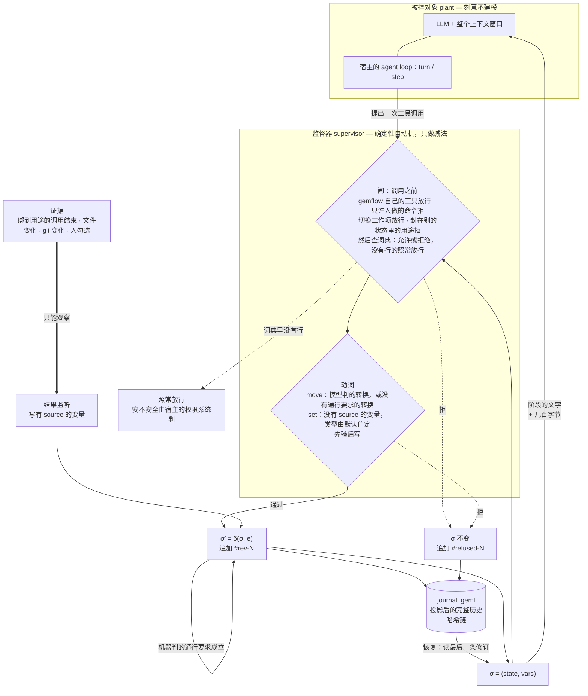

# @geml/gemflow — coding agent 的监督器

[English](README.md) | 中文

一份**用 GEML 写的流程**——一台状态机——决定 agent 此刻能走哪些转换、能写哪些
变量、哪些工具属于它所在的阶段。状态声明**用途**（`edit`、`test`、`deploy-prod`：
作者自己起的词）；流程旁边的一本**工具词典**把每个用途绑到本项目的具体工具上，一个
用途只在声明了它的状态里能用。**证据**——一次测试的退出码、一个 pull request、磁盘上
的一个文件、人的一次勾选——由宿主观测到的事实写入，从不凭模型一句话。每次变化先校验
后落地，并追加进一本**带哈希链的 journal**——journal 本身就是一份普通 GEML 文档，
可读、可寻址、可 diff、可校验。

这不是对 agent 的建模，而是一个 Ramadge–Wonham 意义上的**监督器**：被控对象是
LLM 加它的整个上下文，任意、不建模；监督器在旁边并行运行，只做一件事——把事件
从"接下来可能发生"里拿掉。它买到的是**安全性质**：某些动作序列不可能发生。不是
收敛，也不是对模型行为的预测。



各宿主只提供**机制**；上面每一个**判断**都只有一份（`src/core/supervisor.ts`），
谁也没有第二份拷贝——Claude Code 上它跑在打包好的 CLI 里，插件经一座桥去问它：

| | DeepSeek Harness | pi agent | Claude Code |
|---|---|---|---|
| 调用之前的闸 | `tools/pre-execute`：允许，或带理由拒绝 | `tool_call` → `{ block, reason }`，或什么都不返回 | `tool.call` hook：快路径按手上那份策略判，CLI 经桥裁决并记录；首选工具的问题用 `$.ui.ask` 问人，答案写进 `tools.geml`，词典的默认参数补上调用没写的 |
| 动词的形状 | `move` 与 `set` 按状态重注册：`move` 的枚举就是模型能走的转换，`set` 的参数就是它能写的变量；`status` 一直在 | 每会话只注册一次：`move` 的枚举是流程里的全部目标；不是当前状态出边的 move 被拒并记录 | schema 固定不变（`to` 是任意字符串）；不是出边的 move 被拒 |
| 人的转换 | web GUI 右侧栏的看板：人的转换（标了 `approval` 的也在）、勾变量、暂停；会话的 journal 不是 CLI 的，终端里的 `gemflow advance` 到不了它 | 还没有：会话的 journal 不是 CLI 的，标了 `approval` 的转换在那里没人能走 | 看板，或终端里的 `gemflow advance`；`gemflow mark` 勾一个 source 是人的变量 |
| 证据 | `tool`，来自 `tools/result`：结果报了退出码就用它，否则出错算 1、正常算 0 | `tool`，来自 `tool_result`：出错算退出码 1，正常算 0 | `tool`、`file`、`git`、`human` 四种，经 workspace |
| σ 怎么到模型眼前 | 一段提示词 section + 每步一次的 context 块 | 系统提示词，每个用户回合重建一次 | 让阶段变了的那次调用，结果后面附上新的 `#current`；否则随下一次提交 |
| journal | `<journalDir>/<session>.geml` | 同一个文件，外加每块一条会话条目——分叉出去的会话就是靠它继承整条链的 | `.geml/journals/<工作项>.geml`，每个工作项一本，与 CLI 共用 |
| `.geml/context.geml` | 不写 | 不写 | 写 |

监督器的状态是 `σ = (state, vars)`，允许集一行说完：

> `A(σ)` = 全部工具，去掉绑到本状态没声明用途的、以及词典在本状态拒绝的，⋃ 由模型判
> 或没有通行要求的那些出边，⋃ 没有 `source` 的变量。

绑到本状态没声明的用途的工具被拒，词典在本状态拒绝的工具被拒，其余照常放行。

## 状态

| | |
|---|---|
| 现在可用 | 流程格式，建在 `geml-statechart/v1` 上（没有自己的词汇表）；核心库（流程载入与静态检查、工具词典、按来源分的证据、哈希链修订、journal 渲染/读取/校验、监督器、Stagehand、工作项、backlog 表）；workspace——对一个项目一次只做一个加锁的操作；`gemflow` CLI；五份内置流程（`coding`、`dev`、`matter`、`refund`、`video`），各带自己的词典；Claude Code 插件（输入框上方的状态带、看板、`/gemflow`、`status`、`move`、`set` 三个工具）；给只接 MCP 的宿主用的 `gemflow mcp`；两个宿主适配器——DeepSeek Harness `0.1.5-rc.1` 的 Cordis 插件（看板是其 web GUI 右侧栏的一个标签页）与 pi agent `0.85.x` 的扩展。 |
| 不接模型也测过 | 每一道闸在两个适配器宿主上各测一遍：DSH 侧用 `dsh-agent-loop-testkit` 起真 agent，pi agent 侧用一个按它自己的管线顺序、并且用它自己的参数校验器跑的替身。Claude Code 插件：hooks 模块在 `claude plugin test` 下按真实事件顺序跑，桥接由脚本应答；桥接本身经打包后的 CLI 在临时 git 仓库里测，`gh` 用替身；快路径被钉在 workspace 会拒绝、会记录、会询问的范围上。接真模型跑一遍是手工步骤，见下。 |
| 还不是每个宿主都有 | 来自文件、git 与人的证据，以及当前阶段的上下文文档（`.geml/context.geml`），都经由 workspace 运行。Claude Code 插件把每一次工具调用都交给它，Codex 的 hooks 信任之后也一样，所以四种来源在那里都读得到。只接 MCP 的宿主（`gemflow mcp`：Gemini CLI、Grok、没信任 hooks 的 Codex……）上看不到任何工具调用：`tool` 证据永远写不了，什么都不拒，模型调用 `status` 时它才重新读一遍 git 和文件变量。两个宿主适配器仍是每个会话一本 journal，只写 `tool` 证据；标了 `approval` 的转换在那里还没人能走。 |
| 还没实测 | 在 DeepSeek Harness 上按状态重注册 `move` 与 `set` 对提示词缓存的代价。 |
| bundle 里还带着 | GEML MCP server，以及写作、代码图谱与 gemflow 三个技能（见[安装](#安装)）。 |

设计：[`docs/design/specs/2026-10-11-gemflow-design.md`](docs/design/specs/2026-10-11-gemflow-design.md)。
流程格式与运行时规则：[`spec/workflow_CN.md`](spec/workflow_CN.md)；
状态机格式：[`spec/profiles/geml-statechart/`](../../spec/profiles/geml-statechart/geml-statechart-profile_CN.md)。

## 一份流程

下面是 `gemflow init` 写出来的那份（节选）——管一次 coding 会话的那份。一份流程就是
一个 `diagram` 块，正文是一台状态机：

```geml
=== meta
title   = "Coding workflow"
profile = "geml-statechart/v1"
===

=== diagram {#flow format=geml-statechart caption="Coding workflow"}
{
  "initial": "explore",
  "states": {
    "explore":   { "title": "Explore",   "description": "Read the code before proposing anything; record goal and touched, then move to plan.", "prompt": "#explore" },
    "plan":      { "title": "Plan",      "description": "Write the plan down before touching a file.", "prompt": "#plan" },
    "implement": { "title": "Implement", "description": "Make the change. Editing is possible here and nowhere else.", "prompt": "#implement", "tools": ["edit"] },
    "verify":    { "title": "Verify",    "description": "Run the command; its exit status is the evidence.", "prompt": "#verify", "tools": ["test"] },
    "review":    { "title": "Review",    "description": "Hand back to the person.", "prompt": "#review" },
    "done":      { "title": "Done", "final": true }
  },
  "vars": {
    "goal":       { "default": "", "note": "What this change is supposed to achieve, in one sentence" },
    "touched":    { "default": "", "note": "The files this change edits, space separated" },
    "plan":       { "default": "", "note": "The steps, written before any file is touched" },
    "command":    { "default": "", "note": "The command that decides whether this works, e.g. npm test" },
    "tests-pass": { "default": false, "source": { "tool": "test" } }
  },
  "transitions": [
    { "from": "explore",   "to": "plan",      "guard": "goal and touched are recorded" },
    { "from": "plan",      "to": "implement", "guard": "plan and command are recorded" },
    { "from": "implement", "to": "verify",    "note": "The edit is made; go run the command." },
    { "from": "verify",    "to": "implement", "guard": "the command failed, or the change is not finished", "actions": [{ "reset": ["tests-pass"] }] },
    { "from": "verify",    "to": "review",    "guard": { "properties": { "tests-pass": { "const": true } } } },
    { "from": "review",    "to": "done",      "approval": true },
    { "from": "review",    "to": "implement", "guard": "the person asked for changes", "actions": [{ "reset": ["tests-pass"] }] }
  ]
}
===

## Explore {#explore}

Read the code before proposing anything. …
```

还有项目的 `.geml/tools.geml`——把用途绑到本项目工具上的那本词典，项目的所有流程共用一份：

```geml
=== table {#tools}
| tool             | for  | allow | deny | default | params |
|------------------|------|-------|------|---------|--------|
| Read             |      | *     |      |         |        |
| Grep             |      | *     |      |         |        |
| Edit             | edit |       |      | yes     |        |
| Write            | edit |       |      |         |        |
| Bash(npm test)   | test |       |      | yes     |        |
| Bash(cargo test) | test |       |      |         |        |
===
```

状态依次是 `#explore → #plan → #implement → #verify → #review → #done`。
三种通行要求，三种判断者：对条件变量的一个对象（JSON Schema 的子集）由机器判，这样的
转换在通行要求成立的那一刻自己走——`tests-pass` 写成 true，`#verify` 就到了
`#review`；一句话由模型判，模型认为成立时用 `move` 走；`approval: true` 由人判，在
看板上或用 `gemflow advance` 走，模型从来走不了。通行要求对谁推进都一样生效。带
`source` 的变量是证据：`tests-pass` 由绑到用途 `test` 的一次调用的退出码写入，`set`
拒绝写它。没有 `source` 的变量归模型 `set`，类型由默认值定。`{ "elapsed": "PT2H" }` 读时钟：本阶段停留满这么久即 true，
读它的通行要求就是超时。`done` 标了 `final`：进了它工作项就关闭——没有出边，
证据不再过期——人用 `gemflow rollback` 才能重开。

一个用途只在声明了它的状态里能用。`#implement` 声明了 `edit`，所以 `Edit` 与 `Write`
在那里能跑，在别处都被拒（`Write is edit, which is used only in #implement; the
workflow is in #explore`）；`#verify` 声明了 `test`，所以 `npm test` 只在那里能跑。
词典里没有行的工具照常放行。搬到 Rust 项目，同一份流程把 `test` 绑到 `cargo test`，其余一字不改。这些都不是
写在提示词里、模型可能忘掉或者跟你争的规矩：调用在执行前被拒，拒绝记进 journal。

`geml check` 像验任何 GEML 一样验这份文档；`gemflow check` 再加上状态机自己的检查和
流程的检查（`flow-*`），并对照流程读词典。`geml get .geml/workflows/coding.geml '#flow'`
读这个块；`geml … --to md` 把它投影成 GitHub 能画的 Mermaid 状态图，HTML 渲染器和
viewer 直接画它；`.gemlhistory` 给它记版本。

`gemflow init` 把完整的那份写进 `.geml/workflows/coding.geml` 并设为当前流程；
`--template refund` 写一份审批流程，`--template dev` 写[开发流程](#开发流程)那份从
分支到 production 的流程，`--template video` 写[视频流程](#视频流程)那份一集一集的
流程。

## 它不做什么

它只约束它建模了的那部分世界。下面这些都不是疏漏：

- **回滚恢复的是声明变量与控制状态，不是外部副作用。** journal 能把 `approved`
  拨回 `false`，拨不回已经打出去的退款。补偿要流程作者自己写。
- **工具门控不是沙箱。** 它决定模型在某个状态里能调哪些工具；被放行的 `bash`
  里干了什么，那是 harness 沙箱的事。两层互补。
- **词典读的是命令行，不是命令做了什么。** `Bash(…)` 键是对命令行的一个模式：经由
  词典里没有行的启动器、变量或脚本跑的部署绕得过它，`--dry-run` 的部署按它写的那个
  部署算。把你项目真正会跑的写法写成行。
- **恢复恢复的是状态，不是对话。** 几百字节带回"在哪、接下来能做什么"；对话由
  harness 按它自己的规则重放。
- **一道闸的强度按宿主最弱的那个机制算**，上面那张表写的就是哪一个。pi agent 上
  `move` 的枚举是流程里的全部目标，而不是只有 `σ` 当下的那几条出边，因为 pi agent 的
  工具不能在会话中途重注册；这一步仍然会被拒——晚一步——并且照样记进 journal。

因此适用面是**顺序可枚举的事**——注意这跟「内容可枚举」不是一回事。审批、KYC、
工单分级是容易的那一类：步骤本身事先就知道。

写代码是有意思的那一类。agent 会写出什么，不可枚举，也不该枚举——但**阶段**是可
枚举的：先读再想，先有计划再动文件，先真跑测试再说测试过了。自带的 coding 流程
建模的就是这个，不再细。细到一个文件一个状态、一个函数一个状态，那就是失败模式：
把模型的判断力花在填表上，而且什么都没买到——因为那些步骤的先后本来就不承载意义。
一个步骤排在哪儿无所谓，它就不配拥有一个状态。

## 项目布局

```
.geml/                          在主检出里：仓库的每个 worktree 读的都是这一份
  workflows/<name>.geml         一份流程：一个状态机块，后面跟着各阶段的提示词
  tools.geml                    所有流程共用的工具词典：哪个工具是哪个用途，哪里允许、哪里拒绝
  project.geml                  项目文档：meta flow-workflow 指定默认流程；#items 列着每个工作项和它的结局
  artifacts.geml                每个工作项的产物：链接、在 git 里改过的文档、git 不留的文件，各在哪、第几版
  artifacts/                    git 不留的文件的副本，按内容哈希命名
  journals/<item>.geml          每个工作项一本 journal：一个分支，或一组文件中的一个
  sessions/                     项目的会话记录，各家宿主的会话都在这里
  exports/                      看板导出的文件
  .gitignore                    gemflow 自己的文件，由 gemflow init 写出：它们都不进 git
.geml/                          在每个检出里
  context.geml                  当前阶段的文字与变量，每次换阶段重写
  backlog.geml                  backlog 表
```

旧布局——检出里每个流程一个目录（`flow.geml`、`guide.geml`、`tools.geml`）加
`.geml/gemflow.geml`——照样能读。Claude Code 会话的第一次 status，或者
`gemflow migrate`，会把它搬进主检出：每个目录合成一个文件、guide 的各节并进去，
词典的行并进 `.geml/tools.geml`，`gemflow.geml` 改名 `project.geml`。git 跟踪着的
只复制、留在原处，由你 `git rm`；其余的挪进 `~/.gemflow/trash/`。在旧 `flow.geml`
下开始的 journal，接着在它搬去的那个文件下走。

`gemflow init` 写出的项目文档：

```geml
=== meta
title         = "Gemflow"
flow-workflow = "coding"
===
```

它下面 gemflow 维护一张表 `#items`：项目有过的每个工作项和它的结局，看板每次列工作项时
从 git 读——分支还在、没合并是 `doing`；main 收进了它的提交、或者 PR 已合并，而分支或
worktree 还在，是 `merged`；那些也删了是 `closed`；分支没合并就删了、或者一个提交都
没有，是 `dropped`。文件类的工作项走到流程终点算 `closed`，停在 `parked` 算 `dropped`。
表里记着 git 记不住的——删掉的分支最后的提交、有过几个提交；只重写这张表，你写在它
周围的不动。

产物记在 `artifacts.geml` 的 `#artifacts` 表里，一行一版。工作项写过的文件里 git 不留的，
每回合结束和打开看板时各看一次，内容变了就在 `artifacts/` 存一份副本；单个超过 20 MB
只记位置和哈希。GEML 文档只存一份副本，之后的版本记进它的 `.gemlhistory`。在 git 里的
文档只记路径和最后改它的提交。Artifact 工具发布的页面自动记成链接；别的链接和生成的
图片，模型用 `artifact` 工具记。

默认流程是 `GEMFLOW_STATECHART` 指定的文件（相对项目根的路径），否则是
`flow-workflow` 指定的那个，否则是项目唯一的那个流程。CLI、Claude Code 插件、
`gemflow mcp`、DeepSeek Harness 适配器与 pi agent 适配器都这样找。backlog 提交进仓库；
gemflow 自己的文件不进 git。

## CLI

```
usage: gemflow <check|snapshot|verify|export|init|use|migrate|status|mark|unmark|advance|pause|resume|rollback|run|hook|mcp> ...
  check <workflow.geml>                   static checks of the workflow and its tool dictionary (exit 1 on errors)
  snapshot <journal.geml> [--json]        the last revision
  verify <journal.geml> [--workflow f]    hash chain and consistency
  export <journal.geml> --to md           revision table with per-step diffs
  init [dir] [--template coding|dev|matter|refund|video] [--no-activate]  write a bundled workflow into .geml/workflows/
  use <workflow>                          make a workflow the default for new work items
  migrate                                 move the earlier layout (a workflow directory in the checkout) into the project's home
  status [--json]                         the work item, the stage, its variables and next steps
  mark <variable> | unmark <variable>     a person ticks or clears a variable whose source is a person
  advance <state>                         a person moves the workflow
  pause | resume                          a person holds the work item (evidence is recorded, nothing moves) or lets it go
  rollback [<rev>|checkpoint]             a person restores an earlier revision's state and variables
  run [--profile name] <task>             add the bundle to a dsh profile and run the task there
  hook                                    the Claude Code bridge: one JSON request on stdin, one answer on stdout
  mcp [--host h] [--root dir]             the three model tools over stdio MCP (host default: mcp)
```

- `check` 先跑 `geml check`，再跑状态机的检查（`statechart-*`：没有初始状态、转换指向
  不存在的状态、标了 `final` 的状态有出边、通行要求读了 `vars` 里没声明的变量……），再跑流程的检查（`flow-*`：
  `prompt` 解析不到、`source` 不是已知的任何形式、同两个状态之间有两条转换、一个状态
  有两条机器判的出边、机器判的边成环……），并对照流程读词典——项目的
  `.geml/tools.geml` 对照它的所有流程读（`flow-tools`：哪个流程都没有的状态、一个用途
  有两个首选……）。`prompt` 对照项目解析——就是 `.geml/workflows/` 里放着这个流程的
  那个项目，当前目录是这个项目的检出时就用当前目录——绝不解析到项目之外。
- `snapshot`、`verify`、`export` 读一本 journal。`verify` 重算整条链：修订号连续、每个
  `parent` 等于前一块的哈希、每个哈希按内容重算、并且——给了流程时——每次记录的转换
  都对应一条声明过的边。删掉**末尾**一段块是这条链唯一检测不出的改动。
- `init` 把一份内置流程写成一个文件 `<dir>/.geml/workflows/<template>.geml`（默认
  `coding`，`--template dev`、`matter`、`refund` 或 `video` 则是那一份），把它的词典行
  并进 `.geml/tools.geml`，除非给了 `--no-activate` 就设为默认流程，并在没有
  `.geml/.gitignore` 时写一份。项目已有的流程绝不覆盖。
- `use` 在 `.geml/project.geml` 里改指 `.geml/workflows/` 下的另一个流程（见
  [切换流程](#切换流程)）。
- `migrate` 把旧布局搬进主检出（见[项目布局](#项目布局)），并说明什么搬到了哪里。
- `status` 打开项目——工作项还没有 journal 和 `.geml/context.geml` 时就开一本、写一份——
  然后打印工作项、当前阶段、每个变量和它从哪读，以及每条出边、由谁走、通行要求是否
  成立。`--json` 打印完整的状态。
- `mark` 与 `unmark` 是人勾上、取消一个 `source` 为 `"human"` 的变量；随后通行要求成立
  的机器判的边会被走（`marked review-ready · entered #review`）。`advance` 是人走当前状态
  的一条出边：通行要求必须成立，标了 `approval` 的边不再要另一次同意（这条命令本身就是
  审批），journal 记 `by=human`。`rollback` 以人的身份恢复某条早先修订的状态与变量。
  这几条命令模型一条都不能跑：运行 `gemflow mark|unmark|advance|pause|resume` 的命令行——直接跑，
  经 `npx`、`npm exec`、`node dist/cli.js`，或放在 `bash -c`、`pwsh -c`、`sudo sh -c`、
  `eval`、命令替换里——在每个状态都会在执行前被拒，这次拒绝记进 journal。
- `hook` 是 Claude Code 插件的桥：hooks 模块往它的 stdin 写一个 JSON 请求，从
  stdout 读一行应答。
- `mcp` 用 stdio MCP 提供 `status`、`move`、`set` 三个工具，给没有自己的 Gemflow 外壳的
  宿主用（`--host` 指定词典里的 `Bash(…)` 键对应哪个宿主的工具名，默认 `mcp`，它不跑
  任何命令）。在这种宿主上看不到任何工具调用：`tool` 证据永远写不了，什么都不拒。
  `status` 回答之前会重新读一遍 git 和文件变量，并带上阶段的文字；改变了阶段的 `move`
  把新阶段的文字附在结果后面。
- `run` 是唯一会伸到这个包外面的动词：它在 PATH 上找 `dsh`（找不到就退回
  `npx -y @deepseek-ai/dsh`），把 bundle 加进 profile（不指定就是 `headless`），然后
  把任务交过去，并把 dsh 的退出码原样传回。加失败时它把 dsh 自己的话打出来，再给出
  手工执行的两条命令，绝不在一个没装监督器的 profile 上把任务跑起来。

在一个仓库的功能分支上：

```
$ gemflow init
wrote .geml/workflows/coding.geml (active)
$ gemflow status
feat/rate-limit · #explore
  command = ""
  goal = ""
  plan = ""
  tests-pass = false  (tool:test)
  touched = ""
  → #plan  by move  when goal and touched are recorded
$ gemflow advance plan            # 模型判的转换，人也能走
entered #plan
```

之后在 `#verify` 里、还没有一次跑绿的记录时：

```
$ gemflow advance review
gemflow: verify→review: the guard does not hold (tests-pass=false)
$ gemflow mark tests-pass
gemflow: tests-pass reads its value from the use test; only a variable whose source is "human" is ticked
```

### 工作项与 journal

CLI 每个工作项一本 journal。coding 流程（`flow-unit = "branch"`，默认）里，工作项就是
你所在的分支，它的 journal 是 `.geml/journals/<branch>.geml`——`feat/rate-limit` 写的是
`.geml/journals/feat/rate-limit.geml`。切换分支，下一条命令就作用于那个分支的 journal。
默认分支、游离的 `HEAD`、还没有提交的分支、不是 git 仓库的目录都没有工作项：
`gemflow status` 会说明（`main · not tracked (work items are branches)`），并且什么都不
记录。`flow-unit = "file:<glob>"` 的流程每个匹配的文件一本 journal；它的工作项是宿主的
写入调用最近一次改动的那个文件，所以单靠 CLI 没有工作项。写了 `flow-state-key` 的流程，
文件还在那个 meta 键下记着工作项现在的阶段：操作结束后它说的不一样就写回，日志不在时
就读它，所以到了日志没去过的机器上，工作项从这个阶段起步。Claude Code 插件与
`gemflow mcp` 用的就是这些 journal。

宿主适配器则每个会话一本：DeepSeek Harness 写 `<journalDir>/<session>.geml`，pi agent
写 `<会话目录>/gemflow/<session>.geml`，`#journal` 块里都是 `"item": "session:<id>"`。
两种 journal 互不相干：`gemflow mark` 与 `gemflow advance` 作用于工作项的 journal，从不
作用于某个会话的。

### 切换流程

`gemflow use <name>` 改的是默认流程：**新**工作项在哪份流程下开始。已有 journal 的
工作项继续用它的 journal 开始时的那份流程，所以 `use` 不需要提醒什么；状态带、看板
和 `gemflow status` 在工作项的流程不是默认流程时会点名：

```
$ gemflow use refund
default workflow: refund (a work item with a journal keeps its own)
$ gemflow status
feat/rate-limit · #explore · workflow coding (default refund)
```

流程文件没了的 journal 打不开，并且会说明：把文件找回来，或者把 journal 挪开——改名，
或者删掉——下一个操作就在默认流程下重新开始这个工作项。改了名的 journal 仍然是
journal：`gemflow verify` 拿它开始时的流程来验它。

```sh
mv .geml/journals/feat/rate-limit.geml .geml/journals/feat/rate-limit.coding.geml
gemflow status
gemflow verify .geml/journals/feat/rate-limit.coding.geml --workflow .geml/workflows/coding.geml
```

### 出错时

- 退出码：`0` 完成；`1` 操作失败，stderr 上一行以 `gemflow:` 开头的话，绝不是堆栈；
  `2` 用法错误——未知的动词、缺参数、动词没有的选项（`status --jsno`）。
- 没有流程：``no workflow here: run `gemflow init` ``。有好几个却没选：
  ``choose one with `gemflow use <name>` ``。`.geml/project.geml` 里的名字或
  `GEMFLOW_STATECHART` 找不到文件时照实说。流程有 error 时把它们打出来：
  `<file>: <code>: <message>`。
- 没有工作项：`status` 打印原因并以 0 退出；`mark`、`unmark`、`advance`、`rollback`
  以 1 退出，原因相同。
- 被拒的推进打印原因，以 1 退出；那条转换存在时，这次拒绝也记进 journal。`mark`
  拒绝 source 不是人的变量，也拒绝模型写的变量。
- 不能续用的 journal（校验不通过，或它的状态没了）会说出自己的路径和出路：把它挪开。
- 别的进程拿着 journal 的锁时等 5 秒，之后命令失败，说出锁文件和持有者；确实没有
  gemflow 进程在跑，就删掉那个锁文件。
- `.geml/context.geml` 写不了绝不让命令失败：journal 照写，下一条命令会把上下文文档
  写好。

## 在一个项目上开始用

从零到跑起来，五分钟。东西还没发 npm，所以第一步是从这份检出里打包。

**依赖**：Node 22 以上，加一个 harness——[pi agent](https://pi.dev)
（`npm install -g @earendil-works/pi-coding-agent`）或者 DeepSeek Harness；再加
你给 harness 配的模型 key——监督器不碰它。

`pi install` 收的是包**目录**、`npm:` 源或者 `git:` 源，**不是 `.tgz`**。喂它一个
tarball，它会照单收下、写进 `settings.json`，然后此后每次启动都报
`Unknown file extension ".tgz"`。已经踩了的话，`pi remove <同一个路径>` 就好。

```sh
# 1. 打一个能装的包（把还没发布的解析器打进去）
cd integrations/gemflow && npm install && npm run pack:local

# 2. 装：两个安装器要的东西不一样，pack:local 跑完会把两个路径都打出来
npm install -g ./geml-gemflow-0.2.24.tgz   # CLI：要 tarball
pi install /绝对路径/gemflow-pkg          # pi agent：要一个目录

# 3. 到你要干活的仓库里，开一个自己的分支
cd ~/code/my-project
git switch -c feat/my-change
gemflow init                                     # .geml/workflows/coding.geml，设为默认流程
gemflow check .geml/workflows/coding.geml        # 0 表示它能载入
gemflow status                                   # feat/my-change · #explore

# 4. 干活
pi "把 test/user.test.ts 里那个挂掉的用例修好"
```

第 4 步之后就是一次普通会话，唯一的差别是：模型按状态被告知这个阶段是干什么的、有
哪些工具。自带的词典写的是 Claude Code 的工具名（`Edit`、`Write`、`Bash(npm test)`）；
pi agent 的是 `edit`、`write`、`bash`，对不上。词典里没有行的工具照常放行，所以先把这几行
写好：`edit | edit | | | yes`、`write | edit`、`Bash(node test.mjs) | test`——此后在 `#explore`
里改文件会在执行前被拒，理由用人话给出，并且这条拒绝进 journal。没写这几行，pi 的改文件
不受封路约束。

pi agent 按会话写这本 journal，落在 `<会话目录>/gemflow/<session>.geml`。
`gemflow export <journal> --to md` 读它，`gemflow verify` 验它。在终端里跑的
`gemflow status`、`mark`、`advance` 作用于分支自己的 journal，
`.geml/journals/<branch>.geml`。

**`.geml/workflows/coding.geml` 与 `.geml/tools.geml` 就是全部配置，按你的项目改它们。**
状态和每个状态声明的用途、变量和每个变量从哪读、通行要求；以及你的哪个工具是哪个
用途——全在里面。自带这份做了四个约束：没计划不许改文件、改文件时不许执行命令、
没有真实测试结果不许说完成、最后一步交给人。四条都是强制的：前两条是因为 `edit` 是
`#implement` 的用途、`test` 是 `#verify` 的用途，第三条靠一条机器判的通行要求，读的是
模型写不了的证据，第四条靠一条标了 `approval` 的转换。你的项目要别的顺序，那是改一段
文本，不是改代码。

### 不用 API key，先把整条路看一遍

```sh
npm run walkthrough
```

它会起一个**真的** pi agent 会话，对着一个临时项目（里面有个挂掉的测试），由一个
脚本化的模型（`examples/scripted-model.js`）驱动，所以不需要任何凭证，而且每次输出
一样。除了模型，其它全是真的——pi agent 自己的循环、它的工具管线，`bash` 是真跑的，
写下 `tests-pass` 的是真实的退出码。它会打印每一步模型试了什么、流程拒绝的那几次调用
后来怎样了、以及最后那本 journal；要是有一次被拒的调用跑了，它以退出码 1 结束。想判断
这种约束形态是不是你要的，这是最短的路。

## 安装

### Claude Code

```text
/plugin install gemflow --marketplace geml-spec/geml
```

在终端会话的输入框里输入这一行；按 `y` 添加 marketplace，再选范围。marketplace 里的
条目安装的是已发布的 `@geml/gemflow` 包，所以包发布到 npm 之后这一行才能装上——目前
还没有发布。在那之前，从本仓库载入插件（见下）。

装上之后：

- **输入框上方常驻一行**，终端和桌面 app 都有：
  `G · ⧗ feat/rate-limit · review · ci-pass ✓ · pr-merged ✓ · → #deploy 需批准  [批准] [打回 build] [待处理 3]`
  ——GEML 的 G 标、工作项、阶段、下一道通行要求读的变量、下一步以及它在等什么；然后是
  此刻最紧要的一两个动作（批准或打回、勾上、放行一次、继续、重试）和红色的待处理计数，
  点它打开看板的待处理页；有流程时这一行末尾总有一个「看板」按钮。问不了 gh 时有一段黄色说明；工作项的流程不是默认流程时点名
  它；暂停了会说。在默认分支上显示 `⧗ main · not tracked (work items are branches)`；
  项目里没有流程时写"没有流程"，并按目录里有什么建议一个内置流程（有 geml-media 文档或
  `episodes/` 建议 video；有 wrangler、fly、vercel、Dockerfile 一类部署配置建议 dev；有
  package.json、Cargo.toml 一类构建清单建议 coding；都没有建议 dev），一个按钮加上它，
  另一个打开设置选别的；桥接还没应答时写"启动中"。文字跟着偏好语言或系统语言走：
  中文、English、日本語。
- **`/gemflow`**：当前状态；`/gemflow board [标签]` 打开看板；`/gemflow pause`、
  `/gemflow resume` 暂停、继续工作项；`/gemflow use <流程>` 改默认流程；`/gemflow add`
  列出内置流程，`/gemflow add <流程>` 把一份复制进 `.geml/workflows/`——项目还没有流程
  时同时设为默认流程，否则提示用 `/gemflow use`。
- **看板**，六个标签页，打开停在待处理：待处理（只有你能做的事——通行要求已满足的
  批准、要勾的变量、模型在同一个键上反复被拒、桥接坏了——每项带按钮）、
  工作项（先是当前工作项的产物——`#result` 一节、写过的文件、提交——再是按结局分组的
  工作项：在做、已合并、已收尾、放下，各带 worktree、提交数和 PR；已合并但 worktree
  或分支还在的，出一张收尾卡片，确认后由模型在提交都进了 main 时删掉两者；然后是
  backlog）、记录（顶部"自上次之后"的
  摘要，然后是最新在前的 journal，可筛选；一条展开能看凭什么、哪次调用、在哪份内容上、
  还算不算数）、流程（从模型画出的流程图，叠着运行时：一层一行状态盒子，当前阶段强调色，阶段里的工作项数做角标；每层下面一行一条出边，标着条件成不成立，现在能走的边是带数字热键的按钮——桌面、编辑器、手机、终端都一样；然后是时钟、人勾选的变量）、工具（词典每一行
  在当前状态的处境，能就地改的都有按钮，输入框加一行）、会话（你发过的 prompt 按当时阶段
  分组，附这一轮做了什么；勾中一条可以定位到对话里那一处，或交给模型用随附的
  `split-session` skill 把它和之后的轮次、或只它这一轮拆成单独的会话，原会话先备份；
  导出 GEML / Markdown / JSON）。头部常驻分享（现在在哪、记录、
  本会话、流程——复制文字、写到 `.geml/exports/`、或发 PR 评论）、设置（桌面提醒、状态带
  显示什么、默认流程、添加内置流程或从路径导入、偏好语言）、升级、关于。
- **模型可调的三个工具**：`status`、`move`、`set`，列为 `mcp__gemflow__status`、
  `mcp__gemflow__move`、`mcp__gemflow__set`。它们的 schema 不随状态变，prompt 缓存不会
  因此失效。调用它们从不被闸拒；动词自己的规矩——三种判断者、带 source 的变量——
  照样生效。
- **词典里没有行的工具照常放行，不问人**：它安不安全，由宿主自己的权限系统按实际参数判断。
  词典只回答"这是哪个用途"，从而决定它在哪些阶段能用；要拒绝或绑定，在看板或
  `.geml/tools.geml` 里写一行。绑到某个用途、但该用途的首选是另一个工具（`default` = `yes`）
  的工具会问一次——只这一次，或者改成首选——一行的 `params` 补上调用没写的参数。
- **把阶段的上下文交给模型。** 一次调用让阶段变了，新的 `#current` 随这次调用的结果交给
  模型；两次提交之间变了（人在看板上推进了、会话开始时补齐了 git 的事实），随下一次
  提交交给模型。子 agent 的调用让阶段变了，子 agent 读到它，主线程的下一次提交也照样
  带上。在另一个检出（子 agent 的 worktree）里的工具调用按那个检出的工作项裁决，它的
  阶段交给在那里干活的子 agent。`/clear` 之后的下一次提交重新带上。

在仓库里开始用：`/gemflow add dev`（或 `npx -y @geml/gemflow init --template dev`），
再把 `.geml/tools.geml` 改成项目的测试与部署命令、把 `.geml/workflows/dev.geml` 里各阶段的文字改成项目自己的约定——
[开发流程](#开发流程)一节把它走一遍。

**需要 Node ≥ 22。** hooks 模块在 Claude Code 里运行，没有 Node；凡是碰项目文件的
事——journal、`.geml/context.geml`、词典、backlog——都由打包好的 CLI `dist/gemflow.mjs`
做，每个请求起一次（`node dist/gemflow.mjs hook`：stdin 一个 JSON 请求，stdout 一行
应答）。会话开始时插件找 Node：先在会话的 PATH 上跑 `node --version`；不够再问 shell
——Unix 上是登录 shell（`/bin/sh -lc "command -v node"`），Windows 上是
`cmd.exe /d /c where node`，不是本系统的那个立刻失败——再看安装器放它的地方
（`%ProgramFiles%\nodejs`、`%LOCALAPPDATA%\Programs\nodejs`、nvm-windows 的
`%NVM_SYMLINK%`、Volta、Homebrew、`/usr/local/bin`），第一个主版本 ≥ 22 的就是。每次探测
给 10 秒：node.exe 第一次被杀毒软件读一遍会慢。会话开始时没找到 Node，之后的工具调用、
提交或 `/gemflow` 十秒后就会再试；找到了 Node 但没拿到应答，再试至多一分钟一次。

**失败放行。** 找不到 Node、CLI 失败或超时（15 秒；看板、刷新、`use` 与 `add` 45 秒）、
应答无法解析时，工具调用照常执行、什么都不记，输入框上方那一行显示原因。所以拒绝
只在这座桥正常时生效。应答说请求本身失败了（journal 读不了、锁一直被占）时，插件沿用
手上最近一份策略；从没构建过的 bundle 会连同该跑的构建命令一起说出来。

**这里的用途是什么。** Claude Code 不能把工具从模型的工具表里拿掉，所以阶段的文字
写明本状态声明了哪些用途、每个绑到哪个工具（`Tools here:` 之后每个用途一行：
`edit: Edit`、`test: Bash(npm test)`）——模型看得见的告示牌；调用绑到本状态没声明的
用途的工具，在调用时、执行之前被拒
（`gemflow: Edit is edit, which is used only in #implement; the workflow is in
#explore`），并记为 `#refused-N`。拒绝时会点出每个状态都允许的那条出路：切换工作项
（`git switch`、`git checkout -b`、`git worktree add`、`cd`）。只许人做的命令
（`gemflow mark|unmark|advance|pause|resume`）与封路用途的命令模式，读任何带命令行的工具调用
（Bash、Monitor），命令行里任何位置，去掉引号之后。

**大多数调用不起子进程。** 每个应答都带一份状态与策略的快照——用途、词典的行、文件
glob——插件只在调用可能被拒或被记时才在调用前问 CLI，只在证据可能读到它时才在
调用后问：键绑到了某个变量所读用途、并且带退出码的命令；绑到这样一个用途的工具；写了
文件变量或工作项单位指定的文件；流程有文件变量时的任何执行；命令行任意位置运行了 git
或 gh（切换分支会换掉工作项）；Bash 结果报告了 git 操作；或者 CLI 刚记下了这次调用。
可能作用在另一个检出里的调用一律交给 CLI，由它归属。关于 pull request 与 CI 的 gh 查询
只在会话开始、看板打开或刷新、结果报告了 git 操作（commit、push、合并、PR）的调用之后
进行——`git status` 不会多问一次 gh。

在本仓库里开发这个插件：

```sh
cd integrations/gemflow && npm install && npm run build
cd ../.. && claude --plugin-dir integrations/gemflow
cd integrations/gemflow && npm run test:claude   # claude plugin validate + claude plugin test
```

### 其他宿主（MCP）

`gemflow mcp` 用 stdio MCP 提供同样的三个工具；在宿主的 MCP 配置里登记为
`npx -y @geml/gemflow mcp --host <宿主>`（宿主在项目之外启动服务时加 `--root <目录>`）。
skill `skills/gemflow-mcp/SKILL.md` 要求模型每轮先读阶段（`status`，或
`.geml/context.geml` 的 `#current`）——这类宿主没有把它交给模型的通道。这类宿主
没有的：

- 没有输入框上方那一行，也没有看板；人在终端里用 `gemflow advance` 与 `gemflow mark`
  推进流程、勾变量。
- Gemflow 看不到宿主的任何工具调用，所以 `tool` 证据永远写不了、什么都不拒——封路的
  用途与只许人做的命令都一样。通行要求不论谁推进都生效，`gemflow advance` 也一样，所以
  通行要求要读 `tool` 证据的转换，只有在它也接受一个人勾的变量时才走得了：开发流程的
  `review-ready` 能把 `#build` 带到 `#review`，`#release` 却等着 production 部署的退出码，
  在这类宿主上永远到不了 `#done`，除非给它的通行要求加一个 `human` 变量。
- git 与文件变量在模型调用 `status` 时读；改变了阶段的 `move` 把新的 `#current` 附在
  结果后面。
- 模型走标了 `approval` 的转换会被拒，与 Claude Code 上一样。

### Codex

Codex 照上面拿到三个 MCP 工具，hooks 信任之后还拿到闸：插件的
`.codex-plugin/plugin.json` 指向同一份 `skills/`、`codex/mcp.json`
（`gemflow mcp --host codex`）和 `codex/hooks.json`——SessionStart、UserPromptSubmit、
PreToolUse、PostToolUse 都跑 `node "${PLUGIN_ROOT}/dist/gemflow.mjs" codex`。从本仓库的
Codex marketplace（`.agents/plugins/marketplace.json`，本地来源，先在
`integrations/gemflow` 里 `npm run build`）装：Codex 里 `/plugins` 安装，再 `/hooks`
逐条审阅、信任这四个 hook——装插件不等于信任，没信任的 hook 一声不响地跳过。

hooks 信任之后，Codex 上有的就是 Claude Code 上的减去状态带和看板：阶段文字在会话开始、
变化之后的下一条 prompt、以及改变了它的那次调用的结果里交给模型；封路用途或只许人做的命令
被拒并说明原因；词典里没有行的工具照常放行；工具的默认参数补齐；退出码是证据的 shell 命令被包一层、把退出码打印在输出末尾
（`[gemflow exit N]`，调用后读回来——Codex 的结果不带退出码；命令自己的退出状态照样到
Codex；Windows 上不包）。这里的编辑器是 `apply_patch`：内置词典把它绑到 `edit`，补丁
只按路径判断，不扫它的文本。

### DeepSeek Harness

```sh
dsh plugin --profile web add @geml/gemflow
```

先不启动、只验证这一层，再启动：

```sh
dsh --profile web --dump-config   # 应能看到 "# == @geml/gemflow" 这一层
dsh --profile web
```

bundle 贡献三行：**监督器**（适配器模块 `dist/hosts/dsh/plugin.js`，按路径命名，dsh 才会
连同这个包的浏览器半边一起找到；按 agent 挂载；会话的工作目录里找不到流程时它什么都不做——
这就是 `onMissing: skip`）、**GEML MCP server**
（`npx -y @geml/geml mcp --root .`，限定在会话自己的项目目录内，于是模型一次改一个块
而不是重写整个文件），以及 `skills/` 下的四个**技能**——写作、代码图谱、gemflow 与
split-session（只用于 Claude Code 的会话，它自己写明了）。
要覆盖哪一行，在你 profile 的 `cordis.patch.yml` 里按 `id` 重写，注意把该行需要的每个键
都写全。

监督器那一行不设 `statechart`，于是流程按 `gemflow` 的方式、从会话的工作目录找；
要钉死一个文件，就在这一行里设 `statechart: <路径>`。没有流程的项目被安静地放过。有好几个
流程却没选、名字找不到、或者流程有 error 时，会记日志，这个 agent 不受监督——
`onMissing: fail` 则让它启动失败。

这个宿主上 `move` 与 `set` 在每次通过的动作之后重注册，所以 `move` 的枚举恰好是模型
能走的转换、`set` 的参数恰好是它能写的变量；类型不对的值在动词之前就被 dsh 自己的
校验器拒了。闸跑在 `tools/pre-execute` 里：拒绝就带理由 deny，词典里没有行的键照常放行。`pwsh`
是例外：它的命令行是 PowerShell，sh 的扫描器读不了，所以只有两条不用解析的规则对它
生效——只许人做的动词和封路用途的模式，在整段文字里搜索——它的退出码不记到任何
用途名下。

web GUI（`dsh --profile web`）里，**看板**是右侧栏的一个标签页：引导页列出「Gemflow」，
点开画的就是 Claude Code 看板的那些行——六个标签页里的五个（待处理、工作项、记录、
流程、工具；会话页是人的 prompt 列表与 Claude Code 记录文件上的动作，dsh 的会话是它
自己的）。按键在宿主上跑：人的转换、勾变量、暂停与继续，以及写进 `.geml/tools.geml` 的学习——
「设为首选」「在这个阶段也允许」与「加一行」输入框——监督器下一次判定就重读到。这个宿主
做不了的（导出、对话框、切换流程）不画按钮。文件链接经 dsh 自己的会话接口打开文件，
没有应用认领的就在文件管理器里显示。流程页的图在这里是同一份数据画成的 SVG：现在能走的转换用强调色画，点一下就走。两半分别是 `src/hosts/dsh/board.ts`（路由在
`/api/gemflow` 下）与 `client.js`（包的 `dsh.client` bundle）；监督器那一行按路径命名，
正是为了浏览器半边（见上）。journal 仍按会话记在 `journalDir` 下，会话恢复时读回。

### pi agent

```sh
pi install npm:@geml/gemflow
```

同一个包就是一个 pi package：`pi.extensions` 指向监督器，`pi.skills` 指向同样那
四个技能——它们本来就是一个技能一个 `SKILL.md` 文件夹，正是 pi agent 自己的约定。

流程在**扩展加载时**读一次，因为三个动词必须在第一个会话开始之前注册好，而它们
的 schema 来自流程。它按 `gemflow` 的方式从 pi 启动时所在的目录找；要换别的，用环境
变量说——那个时刻命令行 flag 还没解析：

```sh
GEMFLOW_STATECHART=path/to/workflow.geml pi   # 用这个流程，而不是项目的默认流程
GEMFLOW_JOURNAL_DIR=/var/journals pi      # 默认 <会话目录>/gemflow
```

没有流程时：不注册、不监听，`pi` 的行为和没装这个包完全一样。有好几个流程却没选、
名字找不到、或者流程有 error 时：每个会话都会说明，并且不受监督。

pi agent 这边有一件事只读过它发布的类型与随包文档、没有实测，接真模型跑的时候正是要看
它们：fork 之后 `getBranch()` 给的是分支还是整棵树（`hash`/`parent` 是按它
返回的东西算的，出问题由 `gemflow verify` 抓）。

不装 harness、只用 CLI，就是[在一个项目上开始用](#在一个项目上开始用)第 2 步装上的
`gemflow` 命令：

```sh
gemflow init
gemflow check .geml/workflows/coding.geml
```

git 变量询问 pull request 与 CI 时用的 `gh` 若不是 PATH 上那个，用 `GEMFLOW_GH` 指定。

## 开发流程

`/gemflow add dev`（或 `gemflow init --template dev`）写出 `.geml/workflows/dev.geml`：
状态机后面跟着各阶段的提示词，词典行并进 `.geml/tools.geml`。它的工作项是分支
（`flow-unit = "branch"`），所以在默认分支上什么都不记。五个状态：

```
#build ──机器──▶ #review ──机器──▶ #deploy ──批准──▶ #release ──机器──▶ #done
   ▲                 │
   └── review 要求改动 ┘   （模型判）
```

| 状态 | 用途 |
|---|---|
| `#build` | `edit`、`test`、`pr` |
| `#review` | `edit`、`test` |
| `#deploy` | `deploy-staging` |
| `#release` | `deploy-prod` |

不凭模型一句话就推动它的，是证据：

| 变量 | source | 从哪读 |
|---|---|---|
| `tests-pass` | `{ "tool": "test" }` | 绑到 `test` 的一次调用的退出码——词典里的 `Bash(npm test)`、`Bash(cargo test)`……——在声明了 `test` 的状态里 |
| `pr-open`、`pr-merged`、`ci-pass` | `"pr-open"`、`"pr-merged"`、`"ci-success"` | gh：分支最新的 pull request 开着、已合并；`HEAD` 上每个 CI workflow 最近一次运行都成功 |
| `review-ready` | `"human"` | 人的勾选，在看板上或用 `gemflow mark review-ready` |
| `deployed-staging`、`deployed-prod` | `{ "tool": "deploy-staging" }`、`{ "tool": "deploy-prod" }` | 词典绑到该用途的 `wrangler deploy` 的退出码 |

1. **#build。** 写代码和测试。每跑一次 `npm test`，按退出码记下 `tests-pass`；阶段
   告诉模型不用报告。`build→review` 由机器判，通行要求三者满足其一即成立：测试通过且
   PR 已开；PR 已合并（Gemflow 没来得及看到它开着）；或者有人勾选了 `review-ready`——
   给测试只在 CI 里跑的项目。模型勾不了它：模型运行 `gemflow mark review-ready` 会被
   拒，`set` 拒绝写证据。
2. **#review。** 处理 review 意见。CI 的结论与合并状态是 git 的事实，所以 gh 要已
   登录。合并且 CI 通过后，`review→deploy` 把流程带到 `#deploy`。
3. **#deploy。** 部署到 staging。`deploy-staging` 是 `#deploy` 的用途，`deploy-prod` 是
   `#release` 的：在别的地方，这条命令在执行前被拒——词典有行的每种写法的
   `wrangler deploy --env staging`（`-e staging`、`--env=staging`，前面加 `npx`、`pnpm`
   或 `bunx`），以及带任何别的参数或不带参数的 `wrangler deploy`，它部署的是顶层环境，
   按 production 算。模式在整条命令行里找，`bash -c "…"` 里也找；词典里没有行的启动器、
   变量和脚本绕得过它，`--dry-run` 按它写的那个部署算。用别的工具部署，就把这些行
   改掉。
4. **#release。** `deploy→release` 要人，并且先得有一次 staging 部署：它的通行要求读
   `deployed-staging`。看板上点一下，或者在终端里运行 `gemflow advance release`，这就是
   批准。模型 `move` 到 `#release` 会被拒，并提示去看板。production 部署成功写下
   `deployed-prod`，`release→done` 结束这个工作项。

**退回重做。** `review→build` 由模型判（`review 要求改动`）或人走，并在同一个修订里把
`tests-pass` 与 `review-ready` 清回 false：上一轮跑绿的测试和勾过的 ready 都作废。流程
停在 `#build`，直到测试重新跑绿、人重新勾选 `review-ready`，或者 PR 已合并。一次转换
之后的第一条机器判的边从不回到这次转换刚离开的状态，所以单凭 git 的事实仍成立的通行
要求，也不会把流程立刻弹回去。

**过期。** `tool` 证据盖上工作项内容的章——工作副本的 git tree——在别的内容上写下的
值，到下一次操作时回到 false：改代码之前跑绿的测试，改了之后不算数。

`Bash(…)` 键匹配以它开头的命令，按整词算，`*` 匹配任意一段文字；字面部分最长的键优先
（`Bash(wrangler deploy*--env staging)` 赢过 `Bash(wrangler deploy)`）。把 `test` 的行
改成项目的测试命令、部署的行改成项目的部署命令，再让 guide 指向项目自己的约定。

## 事项流程

`/gemflow add matter`（或 `gemflow init --template matter`）写出
`.geml/workflows/matter.geml`。一件事项一个工作项：`.geml/matters/` 下的一个文件
（`flow-unit = "file:.geml/matters/*.geml"`），记一件事的现象、原因、方案和结果——修个
bug、改个界面、写一条文案。它在自己的 meta 里记着现在的阶段（`flow-state-key = "state"`），
状态跟着文件走。

```
#noted ──模型──▶ #deciding ──批准──▶ #doing ──机器──▶ #checking ──批准──▶ #done
   │                │                 ▲                 │
   └── 直接做（人按）────────────────┘◀──── 打回（人按）┘
                              #parked ⇄（人放下、人重新打开）
```

| 状态 | 用途 |
|---|---|
| `#noted`、`#deciding`、`#checking`、`#parked` | `note`：写事项文件本身 |
| `#doing` | `note`、`edit`（改别的文件）、`check` |

模型把事项写清原因和方案后推到 `#deciding`；其余每条出路都是人按的按钮。`#doing` 在
检查通过时（`check-pass`，来自用途 `check`）、或人勾上 `accept-now` 时自动进入
`#checking`；回到 `#doing` 时两者一起清掉。词典按路径把写文件的工具分开——
`Edit(.geml/matters/*)` 是 `note`，`Edit` 是 `edit`，字面部分最长的优先——也列了 pi 的
`edit`、`write`，所以在 pi 上同样有封路。

## 视频流程

`/gemflow add video`（或 `gemflow init --template video`）写出
`.geml/workflows/video.geml`：状态机后面跟着各阶段的提示词，词典行并进
`.geml/tools.geml`。它的工作项是一集：`episodes/` 下的每份 geml-media 文档
（`flow-unit = "file:episodes/*.geml"`），当前工作项是写入调用最近一次改动的那一集；
它不需要 git。七个状态：

```
#script ─机器─▶ #assets ─机器─▶ #cut ─机器─▶ #render ─机器─▶ #review ─机器─▶ #publish ─机器─▶ #done
                   ▲             ▲ ▲            │               │
                   │             │ └─ 出片失败 ──┘               │
                   │             └─────────── 要改剪辑 ──────────┤
                   └───────────────── 要重出镜头 ─────────────────┘
```

| 状态 | 用途 |
|---|---|
| `#assets` | `image`、`video`、`voice`、`import`、`log`、`todo-check` |
| `#cut` | `lay`、`stale-check` |
| `#render` | `render` |

不凭模型一句话就推动它的，是证据：

| 变量 | source | 从哪读 |
|---|---|---|
| `script-final`、`approved`、`published` | `"human"` | 人的勾选，在看板上或用 `gemflow mark` |
| `assets-done` | `{ "tool": "todo-check" }` | `geml media todo <本集> --check`，看退出码，在 `#assets` 里 |
| `no-stale` | `{ "tool": "stale-check" }` | `geml check <本集> --severity media-stale-clip=error`，看退出码，在 `#cut` 里 |
| `rendered` | `{ "tool": "render" }` | `geml media build … --out <文件>`，看退出码，在 `#render` 里 |

1. **#script。** 写这一集：分镜提示词（`media-text .prompt`）与台词
   （`media-text .line`）。一集只占一个文件——剧本、本集的素材块与生成日志、时间线都在
   里面——因为引用是有方向的，`geml media todo` 只看得见从这一集出发够得着的东西。
   人勾选 `script-final`（剧本定稿）；模型勾不了。
2. **#assets。** 按 `geml media todo episodes/epNN.geml --root . --json` 列出的待办
   生成，每做好一件用 `geml media import` 与 `geml media log` 登记。出图、出视频、配音
   的工具就是用途 `image`、`video`、`voice`：词典里没有它们的行，第一次调用引出的问题
   你答了才有，一行的 `params`（画幅、音色）补上模型没写的参数。
   `geml media todo episodes/epNN.geml --root . --check` 在没有待办时以 0 退出，
   `assets→cut` 把流程带到 `#cut`。
3. **#cut。** 排时间线（`geml media lay`；`geml media export --to player` 出预览）。
   `geml check episodes/epNN.geml --root . --severity media-stale-clip=error` 在没有
   片段用到过期素材时以 0 退出，接着走 `cut→render`。
4. **#render。** `geml media build … --out` 是用途 `render`，只有 `#render` 声明了它：
   在别的阶段，词典有行的每种写法都在执行前被拒（`geml` 前面加 `npx`、`bunx`、
   `pnpm dlx`、`yarn dlx` 或 `npm exec`；`-o` 代替 `--out`）。出片要写 `--out` 和文件，
   不写 build 不会运行，所以只有这样的出片命令才被绑定。进入 `#render` 要求过期检查
   通过，所以改了提示词却没重新生成，就出不了片。出片成功，流程到 `#review`。
5. **#review。** 人看完成片勾选 `approved`（审片通过），流程到 `#publish`；这一集发出去
   之后勾选 `published`（已发布），这个工作项到 `#done`。

输入框上方那一行显示这一集的待办数：
`⧗ episodes/ep02 · assets · 待办 7 项 · assets-done ✗ · → #cut 自动 · 待 assets-done`。
它在会话开始、打开或刷新看板时，由解析器的 `todo` 在进程内算出——就是
`geml media todo <文件> --root . --json` 列出的那些——只在这一集还停在数它时的阶段时
显示，阶段一变就不再显示。超过 999 项显示 `待办 999+ 项`。数的时候出错或超过十秒，或者
解析器受限的文件宿主读不到这一集（链接到项目之外），就不显示数，而不是显示「无待办」。
没有变量读它。

**返工。** `review→assets`（重出镜头）与 `review→cut`（改剪辑）由模型 `move` 或人在
看板上走。两条都在同一个修订里清掉上一轮的证据：`review→assets` 把 `assets-done`、
`no-stale` 与 `rendered` 清回 false，`review→cut` 清 `no-stale` 与 `rendered`。所以待办
检查、过期检查与出片都要重新过一遍，新片也要等人再勾 `approved`。出片失败也这样回去：
`render→cut` 清掉 `no-stale`。并且每个 `tool` 变量都在这一集的文件变了之后过期：改之前
通过的检查，改了之后不算数。

每条命令都写本集的文件并带 `--root .`：词典读的是命令行，在 `file:` 单位下，一条命令的
证据记到它命令行写到的那一集名下，相对它运行的目录。
`geml media todo --check` 在 `@geml/geml` 尚未发布的改动里；发布之前，用本仓库里的
解析器运行（`node geml-parser/dist/cli.js media todo …`），并给这种写法加一行。

## 开发

```sh
npm install        # 把 @geml/geml 链到 ../../geml-parser
npm test           # tsc + 打包 + node --test
npm run test:claude   # 在 claude plugin test 下跑 hooks 模块（需要 claude CLI）
```

`npm run build` 先跑 `tsc`，再把 CLI 打成 `dist/gemflow.mjs`——Claude Code 插件启动的就是
这一个文件（`@geml/geml` 内联，装上的插件不需要再装依赖）。`hooks/register.tsx` 在没有
Node 的环境里运行：它只 import `dist/hosts/claude-code/` 与 `dist/core/` 下不依赖 Node 的
模块，`test/hooks-purity.test.mjs` 沿着这条 import 链逐个检查。hooks 的测试放在 `tests/`
（`claude plugin test` 不进 `node_modules`）；其余由 `test/` 下的 node:test 测，其中
`test/fastpath-parity.test.mjs` 把插件的快路径钉在 workspace 会拒绝、会记录、会询问的
范围上，`test/checks-conformance.test.mjs` 回放
`spec/checks.json`。

`src/core/` 是纯函数库——不碰 `node:fs`、`process`、`console`，也不 import 任何
宿主的包（这几条都有测试钉着）——所以 CLI、Claude Code 的桥、`gemflow mcp` 和两个适配器
共用同一份实现：`statechart.ts` 经解析器的 statechart 模块载入流程，`dictionary.ts`
放键、模式和决定，`signals.ts` 放按来源分的证据，`supervisor.ts` 放闸和动词，
`asking.ts` 放首选工具的那个问题和答案写下的东西。I/O 放在它旁边：`src/host-fs.ts`
（文件、锁、原子写入、遍历项目）、`src/host-git.ts`（git 与 gh，每次都是带超时的参数
数组）、`src/dictionary-io.ts`（磁盘上的词典，每次重读、在它的锁下重写），以及
`src/workspace.ts`——为 CLI 和任何建在它上面的宿主，对一个项目一次只做一个加锁的操作。

目录结构就是从这条规矩来的：`src/core/supervisor.ts` 做判断，`src/hosts/dsh/` 与
`src/hosts/pi/` 只做翻译。两个适配器谁都不许 import 对方的宿主——宿主包都是可选
peer，只装了一家 harness 的人绝不能被解析到另一家的包上，这条有测试拦着。每个宿主
还各有一份 parity 测试（`dsh-parity`、`pi-parity`），拿我们依赖的形状去对已安装的
包做断言：宿主改了接口，红在这儿，而不是红在用户的会话里。

Claude Code 外壳也按这条规矩分在桥的两侧。`src/bridge.ts` 是 `gemflow hook` 的 Node
一侧：每个请求都重新打开 workspace（打开时读 git 的事实，而且别的进程可能在两次请求之间
写过 journal 或词典），并且每个请求都给应答，抛了异常也一样；`src/attribution.ts` 说
一次调用作用在哪个检出、哪个工作项。`src/hosts/claude-code/` 是 hooks 模块 import 的、
不依赖 Node 的一侧：请求与应答的类型、快路径、读 Claude Code 工具结果的函数，以及
状态带、看板与 `/gemflow` 的文字——都是纯函数。`src/mcp.ts` 用 stdio MCP 提供同样的
动词（`src/verbs.ts`）。
